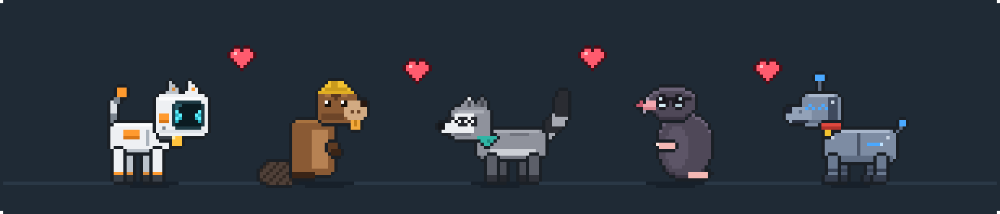
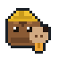
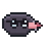
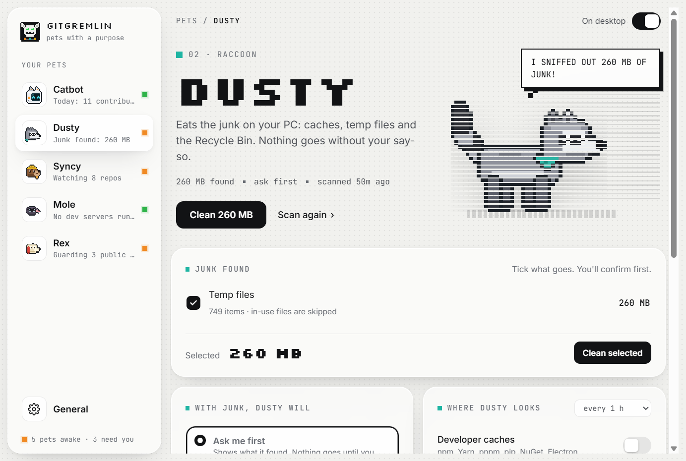

<p align="center">
  
</p>

<h1 align="center">GitGremlin</h1>

<p align="center"><b>Desktop pets with a purpose, for Windows.</b></p>

<p align="center">
  
  
  
  
  
</p>

<p align="center">
  
</p>

GitGremlin puts little pixel-art pets on your Windows desktop, and each one does a job for you. Catbot keeps an eye on your GitHub contributions. Dusty cleans junk files off your PC. Syncy makes sure your work actually reaches GitHub. Mole tells you who's sitting on the port you need, and frees it. Rex sniffs your public GitHub repos for leaked secrets. Pelican carries files from your PC to your phone. They roam, play and talk to you, and you manage them all from one app.

## Contents

- [Coming next](#coming-next)
- [What's new](#whats-new)
- [About](#about)
- [Meet the pets](#meet-the-pets)
- [Features](#features)
- [Installation](#installation)
- [Using GitGremlin](#using-gitgremlin)
- [Privacy and safety](#privacy-and-safety)
- [Troubleshooting](#troubleshooting)
- [Known limitations](#known-limitations)
- [Documentation](#documentation)
- [License](#license)

## Coming next

The next GitGremlin update is in the works:

- **3 new pets:** the first one, **Pelican**, is already here (see [Meet the pets](#meet-the-pets)). Two more are on the way, and all three ship together in the next update.
- **Pets that work in the background:** keep a pet on duty without it showing on your screen. It keeps watching and still warns you when something needs you.

## What's new

### 0.3.1

- **GitGremlin updates itself:** a Windows notification tells you when a new version is ready. Open **General → Updates** to see what's new, then click **Update**. No `git pull` or `npm install` by hand, and your own changes are kept. See [Updating](#updating).

<details>
<summary>Earlier versions</summary>

#### 0.3

- **Mole:** port 3000 already taken? Mole tells you which program has it and frees it in two clicks. It warns you the moment a project you start finds its port taken, and spots dev servers left running after their terminal closed. [Meet Mole →](docs/pets/mole.md)
- **Rex, a wind-up tin toy dog:** sniffs your public GitHub repos for API keys, tokens, private keys, database passwords and `.env` files that should never have been pushed, in current files and recent commits. It barks when it finds one, and links you straight to the line on GitHub. [Meet Rex →](docs/pets/rex.md)
- **One GitHub sign-in, in General:** sign in once under **General → GitHub account**, and every pet that uses GitHub (Catbot and Rex) shares it. Their pages offer the button until you're signed in.
- **Syncy watches repos live:** edits, commits and pushes show up within seconds. **+ Add repo** takes git repos only and refuses duplicates, and unpushed commits name the branch they're on. **Open in VS Code** replaces the terminal button.
- **A new logo:** a black pixel gremlin head on a white tile, minimal and crisp from the 16 px tray icon to the Start menu.
- **Stay along the bottom:** right-click any pet and tick it to keep that pet walking along the bottom of the screen.
- **A tidier panel:** cards in a row share its full width, with no empty columns.

#### 0.2

- **A new logo:** a little pixel gremlin with glowing GitHub-green eyes, on a three-commit graph in the pets' colours (replaced by the black-and-white logo in 0.3).
- **A redesigned panel, "pixel glass":** frosted-glass cards, pixel headings, and each pet drawn large in scanlines. It fills the whole window, and follows your Windows theme (or pick **Light** or **Dark** under General).
- **A new message box on the desktop:** in the same style, sized to its words, with all the text there at once. It opens when you hover a pet and closes the moment you move away.
- **Syncy the beaver:** guards work you haven't pushed to GitHub. [Meet Syncy →](docs/pets/syncy.md)
- **A real Windows app:** open GitGremlin from the Start menu or search ([Installation](#installation), step 5).
- **More in General:** **Hide all pets** for an hour, and the app version.
- **Right-click a pet** for its menu (review, run its job now, open GitGremlin). A plain click just shows its report.

</details>

## About

GitGremlin is a home for **pets with a purpose**:

- **Every pet has a job.** It watches something for you, and its mood and behaviour show you how things stand at a glance.
- **Every pet is 2D pixel art drawn in code.** No image files from elsewhere; each pet has its own look and animations.
- **One app manages them all.** The **GitGremlin panel** in your tray turns pets on and off, and holds every pet's settings.
- **It stays out of your way.** By default pets live on your desktop, behind your app windows, and clicks pass through everywhere except on a pet.

## Meet the pets

| | Pet | What it does | Guide |
|:---:|---|---|---|
|  | **Catbot**<br /><sub>robot cat</sub> | Mirrors today's square on your **GitHub contribution chart**: hungry on days you haven't contributed, happier and livelier the greener the square. New contributions feed it. | [Catbot's guide →](docs/pets/catbot.md) |
|  | **Dusty**<br /><sub>raccoon</sub> | Sniffs out **junk files**: developer caches, the Recycle Bin, and optionally temp files and browser caches. Cleans them only the way you allow: ask first, automatically, or report only. | [Dusty's guide →](docs/pets/dusty.md) |
|  | **Syncy**<br /><sub>beaver</sub> | Guards **work that isn't on GitHub**: uncommitted changes, unpushed commits and forgotten stashes across all your repos. Watches them live, nudges you when work sits too long, and tidies merged branches. | [Syncy's guide →](docs/pets/syncy.md) |
|  | **Mole**<br /><sub>mole</sub> | Digs through your **ports**: shows every dev server and its port, warns you the moment a project you start finds **its port taken**, and **frees the port** (stops whatever holds it) after you confirm. Also spots servers left running after their terminal closed. | [Mole's guide →](docs/pets/mole.md) |
|  | **Pelican**<br /><sub>white pelican</sub> | Carries **files from your PC to your phone**. Drop files on it (as many as you like), show its **QR code**, scan it with your phone and tap **Download all**. Over your Wi-Fi, single use, no app on the phone. Also opens your **dev sites on your phone**. | [Pelican's guide →](docs/pets/pelican.md) |
|  | **Rex**<br /><sub>wind-up tin dog</sub> | Sniffs your **public GitHub repos** for **leaked secrets**: API keys and tokens, private keys, database passwords and URLs, `.env` and credential files. Checks current files and recent commits, after you push and once a day, and barks when it finds one. Read-only. | [Rex's guide →](docs/pets/rex.md) |

More pets are on the way.

## Features

- **One panel for every pet.** Click the tray icon to open the GitGremlin panel. It lists your pets with what each is up to, and gives each pet a page for its job and its look. Changes save as you make them. Light and dark themes follow Windows.
- **Lives on your desktop.** Pets sit just above the wallpaper, so your app windows cover them. Or choose **General → Where pets live → On top of apps** to keep them above everything.
- **One GitHub sign-in.** Sign in once in General; Catbot and Rex share it. It's read-only, approved on github.com, and stored encrypted on your PC.
- **Hover to read their minds.** Hover over a pet and its message box shows its status report. It closes as soon as you move away. Right-click a pet for its menu: review what it found, run its job now, or open GitGremlin.
- **Roams freely.** Pets walk, run, crawl and hop anywhere on the screen. They sit, get curious, walk between monitors and jump onto the window you're working in. Or keep a pet along the bottom of the screen: right-click it and tick **Stay along the bottom**.
- **Plays with you.** Pets can follow your cursor, and you can pick them up, drag them and toss them.
- **Crisp pixel art.** Everything is drawn in whole device pixels, so it stays sharp at any Windows scaling.
- **A real Windows app.** Open it from the Start menu or search, pin it, and start it with Windows.
- **Updates itself.** A Windows notification tells you when a new version is out, and one click in **General → Updates** installs it.
- **Light on your PC.** Rendering slows down when nothing on screen changes. Syncy watches your repos with file events, Mole's port check takes a few milliseconds, and the only internet access is GitHub (Catbot's chart, Rex's public repos, and the update check).

## Installation

GitGremlin runs on **Windows 10 or 11 (x64)**. These steps install it as a normal Windows app: you open it from the Start menu or the taskbar search box, can pin it, and can start it with Windows. You use the terminal only once, to set it up.

**You need:**

| Tool | Why | Version |
|---|---|---|
| [Node.js](https://nodejs.org/) (includes npm) | Installs GitGremlin's packages and builds the app | 22.12 or newer (the current LTS is recommended) |
| [Git](https://git-scm.com/) | Downloads the project, and Syncy uses it to check your repos | any recent version |
| winget (App Installer) | Installs the two tools above with one command each | comes with Windows 10 (1809+) and 11 |
| A GitHub account | For Catbot, which reads your contribution chart, and Rex, which sniffs your public repos | – |

You don't install **Electron** yourself: it's one of the project's packages, and step 4 installs it. All commands below are for **Windows PowerShell** (search "PowerShell" in the Start menu).

### 1. Check what's already installed

```powershell
node -v
git --version
```

If both print a version, and Node.js is **22.12 or newer**, skip to step 3.

<details>
<summary>A fuller check (also winget and npm, and tests the Node.js version)</summary>

```powershell
foreach ($t in 'winget', 'node', 'npm', 'git') {
  if (Get-Command $t -ErrorAction SilentlyContinue) {
    $v = (& $t --version 2>$null) | Select-Object -First 1
    Write-Host ("{0,-7} installed   {1}" -f $t, $v) -ForegroundColor Green
  } else {
    Write-Host ("{0,-7} NOT INSTALLED" -f $t) -ForegroundColor Red
  }
}
if (Get-Command node -ErrorAction SilentlyContinue) {
  node -e "const [a,b]=process.versions.node.split('.').map(Number); console.log(a>22||(a===22&&b>=12) ? 'Node.js version OK' : 'Node.js is too old: update it in step 2')"
}
```

</details>

### 2. Install what's missing

Each command installs a tool only if it isn't there yet:

```powershell
# Node.js LTS (includes npm)
if (Get-Command node -ErrorAction SilentlyContinue) { "Node.js is already installed: $(node --version)" } else { winget install --id OpenJS.NodeJS.LTS -e --source winget }

# Git
if (Get-Command git -ErrorAction SilentlyContinue) { "Git is already installed: $(git --version)" } else { winget install --id Git.Git -e --source winget }
```

Node.js installed but too old? Update it:

```powershell
winget upgrade --id OpenJS.NodeJS.LTS -e --source winget
```

Then **close PowerShell and open a new window**, so it picks up the new commands, and run the check from step 1 again.

<details>
<summary>No winget? Install them by hand</summary>

- **winget** itself: install or update **App Installer** from the Microsoft Store.
- **Node.js:** download the LTS installer (`.msi`) from <https://nodejs.org/> and keep the default options.
- **Git:** download the installer from <https://git-scm.com/download/win> and keep the default options.

</details>

### 3. Download GitGremlin

Pick a folder for it. This example uses `D:\git-gremlin`. Any folder works, but **keep it there afterwards**, because the Start menu shortcut points to it.

```powershell
cd D:\
git clone https://github.com/premkajiwala-hub/git-gremlin.git
cd git-gremlin
```

Without Git: on the GitHub page, click **Code → Download ZIP** and extract it (for example to `D:\git-gremlin`). Then run `cd D:\git-gremlin` in PowerShell.

### 4. Install GitGremlin's packages (including Electron)

```powershell
npm install
```

This installs everything the project needs into `node_modules`, including the Electron runtime (about 100 MB, downloaded once). It takes a minute or two.

> npm may list packages whose install scripts haven't been reviewed. That's only a notice: nothing to do.

### 5. Install GitGremlin as a Windows app

```powershell
npm run install-app
```

This builds GitGremlin and adds **GitGremlin**, with its icon, to your Start menu. To double-check:

```powershell
Test-Path "$env:APPDATA\Microsoft\Windows\Start Menu\Programs\GitGremlin.lnk"
```

`True` means it's installed. Optionally, put a shortcut on your desktop too:

```powershell
Copy-Item "$env:APPDATA\Microsoft\Windows\Start Menu\Programs\GitGremlin.lnk" ([Environment]::GetFolderPath('Desktop'))
```

### 6. Open GitGremlin

1. Press the **Windows key** (or click the taskbar search box), type **GitGremlin**, and press **Enter**.
2. The pets appear on your desktop, and the GitGremlin icon appears in the system tray, bottom right. It may be hidden under the **^** arrow.
3. Click the tray icon to open the **GitGremlin panel**:
   - **General → GitHub account → Sign in with GitHub** links your GitHub account once, for every pet that uses it (Catbot and Rex). Their pages also offer the button until you're signed in.
   - **Dusty** shows the junk it finds. Nothing is deleted until you confirm.
   - **Syncy** lists repos with work that isn't on GitHub yet. It finds your repos by itself.
   - **Mole** shows your running dev servers and their ports, and frees a port you need.
   - **Rex** sniffs your public GitHub repos for leaked secrets, using the same GitHub sign-in.
   - **Pelican** sends files to your phone: drop files on it, then scan its QR code.
   - **General → System → Start with Windows** brings the pets back every time you sign in.

To keep it handy, right-click **GitGremlin** in the Start menu and choose **Pin to Start** or **Pin to taskbar**. Opening GitGremlin while it's already running opens the panel. To stop it, right-click the tray icon and choose **Quit**.

> **Why not a normal installer?** Windows 11's **Smart App Control** blocks unsigned installers, and GitGremlin isn't code-signed. Instead, the Start menu shortcut runs the signed Electron runtime with your GitGremlin folder, which Smart App Control allows. On PCs without Smart App Control you can also use the [installer from GitHub Actions](docs/development.md#building-the-installer).

### Updating

From 0.3.1 on, **GitGremlin updates itself**. When a new version is out, a Windows notification tells you, the tray menu shows **Update to ...**, and **General → Updates** lists what's new. Click **Update to ...**: GitGremlin downloads the new version and restarts. If the update brings new packages, it closes for about a minute while it installs them, then opens again by itself. If anything goes wrong, it puts the old version back.

- **Cloned with git:** files you changed and commits of your own are kept. If one of your changes clashes with the update, the update wins and your change is saved in `git stash`.
- **Downloaded as a ZIP:** it downloads the new version and copies it over your folder. Your settings are kept.
- **Run with `npm start`:** it updates the same way, then reopens as the normal app.

**On an older copy** (no **Updates** card under General)? Update by hand once, and from then on it updates itself:

```powershell
cd D:\git-gremlin
git pull
npm install
```

Quit GitGremlin from the tray first, then open it as usual: it rebuilds itself on start, which takes a few seconds. If you downloaded a ZIP, download the new ZIP instead and run `npm install` in it.

### Uninstalling

1. In the panel, turn off **General → System → Start with Windows**, then choose **Quit** from the tray icon.
2. Remove the shortcut, your GitGremlin data (settings, pet positions, the encrypted GitHub token) and the project folder:

   ```powershell
   Remove-Item "$env:APPDATA\Microsoft\Windows\Start Menu\Programs\GitGremlin.lnk"
   Remove-Item -Recurse -Force "$env:APPDATA\GitGremlin"
   Remove-Item -Recurse -Force D:\git-gremlin
   ```

3. Optionally, remove GitGremlin's access to your GitHub account under GitHub → Settings → Applications → *Authorized OAuth Apps*.

Node.js and Git stay installed. If you don't need them, remove them with `winget uninstall --id OpenJS.NodeJS.LTS -e` and `winget uninstall --id Git.Git -e`.

## Using GitGremlin

### The GitGremlin panel

<p align="center">
  
</p>

Click the tray icon to open it. The sidebar lists every pet with a status dot:
- 🟢 on the desktop;
- 🟠 wants your attention;
- ⚪ off.

| Page | What's there |
|---|---|
| **A pet's page** | An **On desktop** switch, the pet's own job settings (see its guide), and **Look and movement** |
| **General** | **Updates** (what's new, and one-click updates), **GitHub account** (one sign-in for Catbot and Rex), **Where pets live** (on the desktop, or on top of apps), **Start with Windows**, **Hide all pets** for an hour, **Theme** (Auto, Light or Dark) and the app version |

**Look and movement** is the same for every pet:

| Setting | What it does |
|---|---|
| **Name** | Shown in its message box and the tray |
| **Size** | 48–112 px tall, snapped to crisp whole pixels |
| **Walking speed** | Running is about 2.4× and crawling 0.45× this |
| **Where it wanders** | Anywhere on the screen, or only along the bottom (also on its right-click menu: **Stay along the bottom**) |
| **Follow my cursor** | Walks after the cursor while you move it over the desktop |

### The tray icon

- **Click** to open the panel.
- **Right-click** for quick actions:
  - **Update to ...** when a new version is ready;
  - one submenu per pet, with its status, **Show on desktop** and its own actions;
  - **Hide all pets for 1 hour** / **Show pets**;
  - **Start with Windows**;
  - **Quit**.

### Playing with the pets

| Do this | The pet does this |
|---|---|
| Move the cursor over the desktop | Follows it (if **Follow my cursor** is on) and stops when it reaches it |
| Hover over it | Stops, faces you and shows its message box; it closes the moment you move away |
| Click it | Looks up at you and shows its report |
| Right-click it | Opens its menu: its own actions (like **Review junk...**, **Check my repos now**, **Free a port** or **Sniff my repos now**), **Stay along the bottom**, **Open GitGremlin** and **Put it away** |
| Drag it | Dangles from your cursor |
| Toss it | Flies, bounces off the screen edges and may land on a window; flick it hard for a red flash |

Pets are awake the whole time GitGremlin runs. Turn one off with its switch, or quit from the tray.

## Privacy and safety

- **Your GitHub account:** you sign in once (General → GitHub account) through GitHub's own sign-in, with read-only access, and Catbot and Rex share it. The token is stored encrypted on your PC, and Sign out forgets it and what Rex found. [Details →](docs/pets/catbot.md#privacy-and-your-github-account)
- **Your files:** Dusty only looks in a fixed list of junk locations inside your user folders. It never follows links, skips files in use, and by default deletes nothing until you confirm. [Safety rules →](docs/pets/dusty.md#safety-rules)
- **Your repos:** Syncy only reads them with git. It never fetches or pushes, and the only change it can make is deleting merged local branches, after you confirm. [Safety →](docs/pets/syncy.md#safety)
- **Your processes:** Mole only reads which programs listen on which ports. It stops a server only when you ask and confirm, never Windows itself or your terminal. [Safety →](docs/pets/mole.md#safety)
- **Your public repos:** Rex only reads public repos you own, with GET requests and your one GitHub sign-in (General → GitHub account). It never changes a repo, and keeps only masked previews of what it finds, never the secrets themselves. [Safety →](docs/pets/rex.md#safety-and-privacy)
- **Your files on your phone:** Pelican shares only the files you put in its pouch, only while its QR code is showing, only on your Wi-Fi, and only with the first device that opens the link. It switches off once that device has the files, or after 30 minutes without use. Nothing goes to the internet. [Safety →](docs/pets/pelican.md#safety-and-privacy)
- **Network:** the only internet access is GitHub: Catbot's contribution check, Rex's reads of your public repos, and the update check. Every 6 hours GitGremlin reads its list of releases on GitHub, and it downloads an update only when you click **Update**. Turn the check off under **General → Updates**. Dusty, Syncy and Mole work offline, and Pelican only uses your local Wi-Fi.
- **Your data stays local:** settings and state are in `%APPDATA%\GitGremlin\state.json`.

## Troubleshooting

| Problem | Fix |
|---|---|
| `'node'`, `'npm'` or `'git'` is not recognized | Close PowerShell and open a new window after installing. If that doesn't help, sign out of Windows and back in. |
| `npm.ps1 cannot be loaded because running scripts is disabled` | Run `Set-ExecutionPolicy -Scope CurrentUser RemoteSigned`, or use `npm.cmd` instead of `npm` (for example `npm.cmd install`). |
| `winget` is not recognized | Install or update **App Installer** from the Microsoft Store, or install Node.js and Git by hand (step 2). |
| `npm install` fails with network errors | Check your internet connection or proxy, then run `npm install` again. |
| `Failed to load URL: ... hub.html ... ERR_FILE_NOT_FOUND` | The built copy is out of date. Quit GitGremlin from the tray and run `npm run install-app` again. |
| The taskbar, Start menu or tray still shows the old logo | Windows caches icons. Run `ie4uinit.exe -show` in PowerShell, or unpin GitGremlin and pin it again. Signing out of Windows and back in also clears it. |
| Nothing happens when you open GitGremlin | It's probably already running: look for its tray icon. If it's stuck, end **Electron** in Task Manager and open GitGremlin again. |
| `Unable to move the cache: Access is denied` | Two copies were running at once. Quit GitGremlin, end any leftover **Electron** processes, and open it again. |
| An update failed | GitGremlin puts the old version back and says so under **General → Updates**. The details are in `%APPDATA%\GitGremlin\update\update.log`. |
| GitGremlin closed by itself | `%APPDATA%\GitGremlin\exits.log` records when it starts and stops, and why. Open it again from the Start menu. |
| The pets don't show | App windows hide them in desktop mode: press **Win+D**, or choose **General → Where pets live → On top of apps**. Also check each pet's **On desktop** switch. |

## Known limitations

- **In desktop mode, app windows hide the pets** (that's the point), and pets only follow the cursor over the visible desktop.
- **Full-screen games and apps cover the pets, even in on-top mode.** So do the Start menu, notification centre, Alt+Tab and Task View.
- Window hopping uses the **focused** window only, and skips maximised and full-screen windows.
- Dragging works only on the monitor the pet is on. To change monitors, toss it or let it walk.
- Each pet has its own limits; see [Catbot's](docs/pets/catbot.md#limitations), [Dusty's](docs/pets/dusty.md#limitations), [Syncy's](docs/pets/syncy.md#limitations), [Mole's](docs/pets/mole.md#limitations), [Rex's](docs/pets/rex.md#limitations) and [Pelican's](docs/pets/pelican.md#limitations) guides.

## Documentation

| Guide | What's inside |
|---|---|
| [Catbot](docs/pets/catbot.md) | Linking GitHub, how its mood works, feeding, settings, privacy |
| [Dusty](docs/pets/dusty.md) | Cleaning modes, where it looks, safety rules, settings |
| [Syncy](docs/pets/syncy.md) | What counts as unsaved work, where it looks, nudges, merged branches, safety |
| [Mole](docs/pets/mole.md) | Freeing a port, port-taken warnings, running servers, servers left running, safety |
| [Rex](docs/pets/rex.md) | What it sniffs out, files and history, when it sniffs, fixing a leak, privacy |
| [Pelican](docs/pets/pelican.md) | Sending files to your phone, the single-use QR code, your sites on your phone, if your phone can't open it |
| [Publishing an update](docs/releasing.md) | How updates reach everyone, releasing a version, testing an update |
| [Development guide](docs/development.md) | Dev mode, project structure, how it works, pet art, adding a pet, building the installer |

## License

[MIT](LICENSE). All pet art is original to this project and drawn in code.
