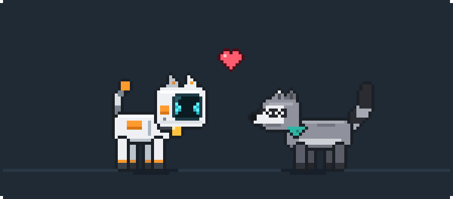
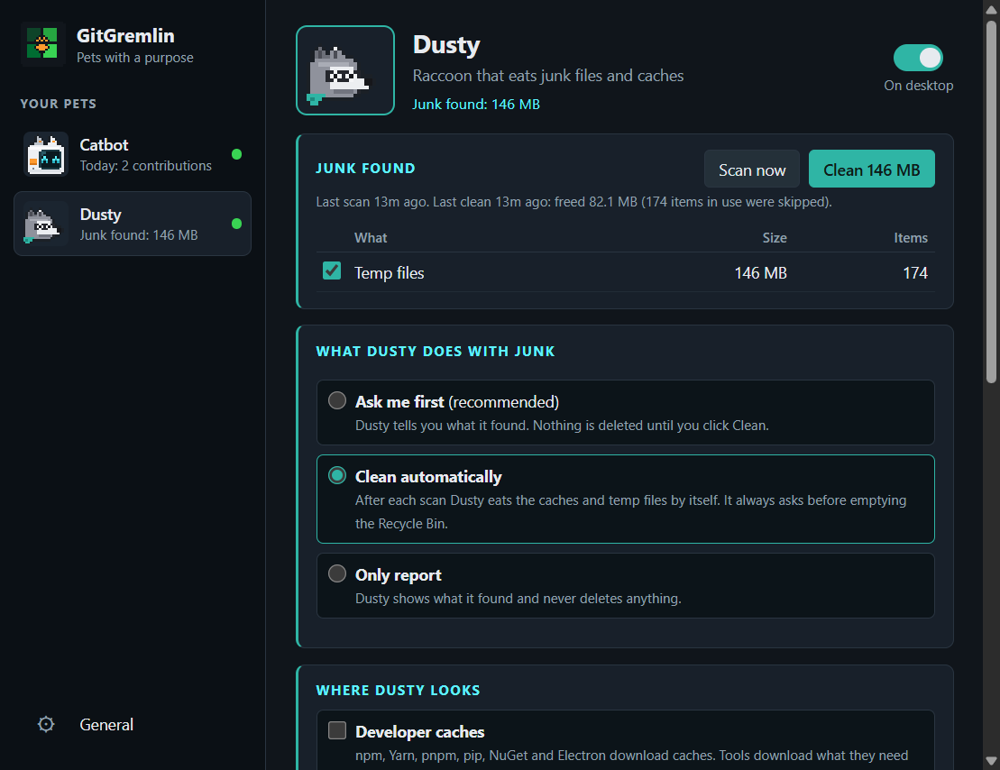
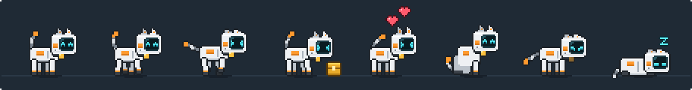
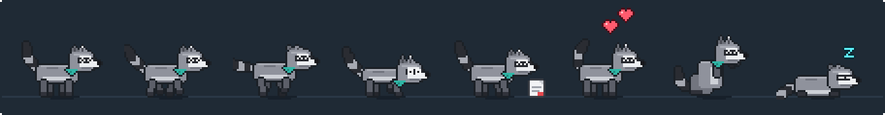

<p align="center">
  
</p>

<h1 align="center">GitGremlin</h1>

<p align="center"><b>Desktop pets with a purpose, for Windows 10 and 11.</b></p>

<p align="center">
  
</p>

GitGremlin is a Windows home for **desktop pets with a purpose**. Each pet is 2D pixel art, drawn in code, roaming your desktop, and each one does a job for you. You manage all of them from one panel, the **GitGremlin** app in your tray.

| | Pet | What it is | Its job |
|---|---|---|---|
|  | **Catbot** | A little robot cat with a white shell, orange stripes, a cable tail and a glowing face-screen | Gets hungry on days you haven't contributed on GitHub, and livelier the greener today's square is |
|  | **Dusty** | A grey raccoon (a "trash panda") with a ringed tail and a teal bandana | Sniffs out cache, temp and Recycle Bin junk and eats it, but only what is safe and only how you allow |

## Features

- **One panel for every pet.** Click the GitGremlin tray icon to open it. The sidebar lists your pets with what each is up to; each pet has a page for its job and its look and movement. Changes save as you make them.
- **Lives on your desktop.** By default the pets sit just above the wallpaper: your app windows cover them and they show wherever the desktop shows. Turn on **Show pets on top of apps** (General) to keep them above everything.
- **Hover to read their minds.** Hover over a pet and its speech bubble shows its status report for as long as you hover. Click a pet that wants something (sign in, review junk) and its page opens in the panel.
- **Roam freely.** They walk, run, sneak (crawl) and hop anywhere on the screen, sit, get curious, walk between monitors, and jump onto the top edge of the window you're working in. Or keep a pet *Only along the bottom of the screen*.
- **Follow the cursor** (per pet, on for Catbot by default).
- **Pixel-art animations:** idle, walk, run, crawl, sit, jump, eat, happy hops with hearts, droop, flop, dangle while dragged, squash on landing and a red flash when flicked hard. Dusty also rummages through junk and washes its paws after a meal. Always drawn in whole device pixels, so they stay crisp.
- **Click-through.** The overlay ignores the mouse everywhere except over a pet.
- **Robot speech bubbles,** in each pet's colours, that type themselves out.

## Installation

GitGremlin runs on **Windows 10 or 11 (x64)**. These steps install it as a normal Windows app: you open it from the Start menu or the taskbar search box, can pin it, and can start it with Windows. You only use the terminal once, to set it up.

You need:

| Tool | Why | Version |
|---|---|---|
| [Node.js](https://nodejs.org/) (includes npm) | Installs GitGremlin's packages and builds the app | 22.12 or newer (the current LTS is recommended) |
| [Git](https://git-scm.com/) | Downloads the project (optional: you can download a ZIP instead) | any recent version |
| winget (App Installer) | Installs the two tools above with one command each | comes with Windows 10 (1809+) and 11 |
| A GitHub account | For Catbot, which reads your contribution chart | – |

You don't install **Electron** yourself. It's one of the project's packages, so step 4 installs it into the project folder.

All commands below are for **Windows PowerShell**. Open it from the Start menu (search "PowerShell").

### 1. Check what's already installed

Paste this into PowerShell. It lists each tool and its version, or says it's missing:

```powershell
foreach ($t in 'winget', 'node', 'npm', 'git') {
  if (Get-Command $t -ErrorAction SilentlyContinue) {
    $v = (& $t --version 2>$null) | Select-Object -First 1
    Write-Host ("{0,-7} installed   {1}" -f $t, $v) -ForegroundColor Green
  } else {
    Write-Host ("{0,-7} NOT INSTALLED" -f $t) -ForegroundColor Red
  }
}
if (Get-Command node -ErrorAction SilentlyContinue) {
  node -e "const [a,b]=process.versions.node.split('.').map(Number); console.log(a>22||(a===22&&b>=12) ? 'Node.js version OK' : 'Node.js is too old: update it in step 2')"
}
```

If everything shows as installed and the Node.js version is OK, skip to step 3.

### 2. Install what's missing

These commands only install a tool if it isn't there yet:

```powershell
# Node.js LTS (includes npm)
if (Get-Command node -ErrorAction SilentlyContinue) { "Node.js is already installed: $(node --version)" } else { winget install --id OpenJS.NodeJS.LTS -e --source winget }

# Git
if (Get-Command git -ErrorAction SilentlyContinue) { "Git is already installed: $(git --version)" } else { winget install --id Git.Git -e --source winget }
```

Node.js installed but too old? Update it:

```powershell
winget upgrade --id OpenJS.NodeJS.LTS -e --source winget
```

**Close PowerShell and open a new window** after installing, so it picks up the new `node`, `npm` and `git` commands. Then run the check from step 1 again.

<details>
<summary>No winget? Install them by hand</summary>

- **winget** itself: install or update **App Installer** from the Microsoft Store.
- **Node.js:** download the LTS installer (`.msi`) from <https://nodejs.org/> and keep the default options.
- **Git:** download the installer from <https://git-scm.com/download/win> and keep the default options.

</details>

### 3. Download GitGremlin

Pick a folder for it. This example uses `D:\git-gremlin`; any folder works, but **keep it there afterwards**, because the Start menu shortcut points to it.

```powershell
cd D:\
git clone https://github.com/premkajiwala-hub/git-gremlin.git
cd git-gremlin
```

Without Git: on the GitHub page click **Code → Download ZIP**, extract it (for example to `D:\git-gremlin`), then run `cd D:\git-gremlin` in PowerShell.

### 4. Install GitGremlin's packages (including Electron)

From the `git-gremlin` folder:

```powershell
npm install
```

This installs everything the project needs into `node_modules`: Electron, electron-vite (the build tool), TypeScript and koffi (the small Windows helper). It takes a minute or two.

Check that Electron works. The first run downloads the Electron runtime (about 100 MB), then prints its version:

```powershell
npx electron --version
```

> **If npm says install scripts were blocked** (npm 11+ asks before running packages' install scripts): run `npm install-scripts approve koffi electron-winstaller`, then `npm rebuild`.

### 5. Install GitGremlin as a Windows app

```powershell
npm run install-app
```

This builds GitGremlin and adds **GitGremlin** to your Start menu, with its icon. When it's done it prints where the shortcut was saved. To double-check:

```powershell
Test-Path "$env:APPDATA\Microsoft\Windows\Start Menu\Programs\GitGremlin.lnk"
```

`True` means it's installed. Optional: also put a shortcut on your desktop:

```powershell
Copy-Item "$env:APPDATA\Microsoft\Windows\Start Menu\Programs\GitGremlin.lnk" ([Environment]::GetFolderPath('Desktop'))
```

### 6. Open GitGremlin

1. Press the **Windows key** (or click the taskbar search box), type **GitGremlin**, and press **Enter**.
2. The pets appear on your desktop and the GitGremlin icon appears in the system tray, bottom right. If you can't see it, it may be under the **^** arrow.
3. Click the tray icon to open the **GitGremlin panel**:
   - **Catbot → Sign in with GitHub** links your contribution chart.
   - **Dusty** shows the junk it finds. Nothing is deleted until you confirm.
   - **General → Start GitGremlin with Windows** brings the pets back every time you sign in.

To keep it handy, right-click **GitGremlin** in the Start menu and choose **Pin to Start** or **Pin to taskbar**. Opening GitGremlin while it's already running just opens the panel. To stop it, right-click the tray icon and choose **Quit**.

> **Why not a normal installer?** Windows 11's **Smart App Control** blocks unsigned installers, and GitGremlin isn't code-signed. The Start menu shortcut instead runs the signed Electron runtime from `node_modules` with your GitGremlin folder, which Smart App Control allows. On PCs without Smart App Control you can also use the installer from GitHub Actions (see [Build the installer](#build-the-installer)).

### Updating

```powershell
cd D:\git-gremlin
git pull
npm install
```

Then open GitGremlin as usual. If the code changed, it rebuilds itself on start (this takes a few seconds the first time) and then launches. If GitGremlin was running during the update, quit it from the tray first.

### Uninstalling

1. In the panel, turn off **Start GitGremlin with Windows**, then **Quit** from the tray icon.
2. Remove the shortcut, your GitGremlin data (settings, pet positions, the encrypted GitHub token) and the project folder:

```powershell
Remove-Item "$env:APPDATA\Microsoft\Windows\Start Menu\Programs\GitGremlin.lnk"
Remove-Item -Recurse -Force "$env:APPDATA\GitGremlin"
Remove-Item -Recurse -Force D:\git-gremlin
```

3. Optional: remove GitGremlin's access to your GitHub account under GitHub → Settings → Applications → *Authorized OAuth Apps*.

Node.js and Git stay installed. Remove them with `winget uninstall --id OpenJS.NodeJS.LTS -e` and `winget uninstall --id Git.Git -e` if you don't need them.

### Troubleshooting

| Problem | Fix |
|---|---|
| `'node'`, `'npm'` or `'git'` is not recognized | Close PowerShell and open a new window after installing, so it picks up the new commands. If that doesn't help, sign out of Windows and back in. |
| `npm.ps1 cannot be loaded because running scripts is disabled on this system` | Allow your own scripts for your user account: `Set-ExecutionPolicy -Scope CurrentUser RemoteSigned`, or use `npm.cmd` instead of `npm` (for example `npm.cmd install`). |
| `winget` is not recognized | Install or update **App Installer** from the Microsoft Store, or install Node.js and Git by hand (step 2). |
| `Failed to load URL: ... hub.html ... ERR_FILE_NOT_FOUND` | The built copy is out of date. Quit GitGremlin from the tray and run `npm run install-app` again. |
| Nothing happens when you open GitGremlin | It's probably already running: look for its tray icon (it opens the panel when you open GitGremlin again). If it's stuck, end **Electron** in Task Manager and open GitGremlin again. |
| `Unable to move the cache: Access is denied` in the terminal | Two copies were running at once. Quit GitGremlin from the tray (and end any leftover **Electron** processes), then open it again. |
| The pets don't show | In desktop mode, app windows hide them: press **Win+D** to show the desktop, or turn on **Show pets on top of apps** (General). Also check each pet's **On desktop** switch. |
| `npm install` fails with network errors | Check your internet connection or proxy, then run `npm install` again. |

## Run it in dev mode

For working on GitGremlin itself (needs steps 1–4 of [Installation](#installation)). Quit the installed app first: only one copy runs at a time.

```bash
npm start
```

The pets appear on your desktop and the GitGremlin icon appears in the system tray. Click it to open the panel; right-click it for quick actions.

> npm 11+ may block install scripts. If `npm install` says `koffi` or `electron-winstaller` scripts were blocked, run `npm install-scripts approve koffi electron-winstaller` and `npm rebuild`. (They're already listed in `allowScripts` in `package.json`.)

While `npm start` runs, two dev pages are available in a browser:

- <http://localhost:5173/preview.html>: a fake desktop with both pets and buttons to feed Catbot, set its contribution level, make Dusty scan and clean, and move the "window" they stand on.
- <http://localhost:5173/sheet.html?pet=dusty&k=6>: every animation frame of a pet (`catbot` or `dusty`), enlarged (`k` = zoom).

## The GitGremlin panel

<p align="center">
  
</p>

| Page | What's there |
|---|---|
| **Catbot** | On/off switch · GitHub sign-in, today's contributions, streak and last 7 days · Look and movement |
| **Dusty** | On/off switch · Junk found (with **Scan now** and **Clean**) · What Dusty does with junk · Where Dusty looks · Look and movement |
| **General** | Show pets on top of apps · Start GitGremlin with Windows |

**Look and movement** (each pet): Name · Size (48–112 px, snapped to a crisp whole-pixel scale) · Walking speed (running is ~2.4×, crawling ~0.45×) · Where it wanders (anywhere, or only along the bottom) · Follow my cursor.

Tray menu: Open GitGremlin · one submenu per pet (status, Show on desktop, its quick actions, Settings...) · Hide all pets for 1 hour · Show pets · Start with Windows · Quit.

A second launch passes flags to the running app: `--settings` (open the panel), `--feed [catbot|dusty]` (debug snack), `--scan` (Dusty scans now), `--say "text"` (Catbot speaks).

## Catbot: fed by your GitHub contributions

<p align="center">
  
  <br /><sub>Idle · walk · run · eating a commit cube · happy · sit · hungry · asleep</sub>
</p>

Catbot reads your **GitHub contribution chart**, the green squares on your profile, and today's square sets its mood. It isn't tied to any one repo: every commit, PR, issue and review that counts on your profile counts for Catbot.

Linking always goes through GitHub's own sign-in:

1. Panel → **Catbot** → **Sign in with GitHub**.
2. GitGremlin shows a one-time code (already copied to your clipboard) and opens <https://github.com/login/device>.
3. Paste the code on GitHub and approve **GitGremlin**. It asks only for `read:user`: read-only access to your profile.
4. The panel switches to your avatar, name and @username, and Catbot says hello.

This is GitHub's OAuth **device flow**, the same one the GitHub CLI and VS Code use. Your password never touches the app, and the token is stored encrypted on your PC (Windows DPAPI via Electron `safeStorage`). **Sign out** forgets it. To revoke access completely, remove GitGremlin under GitHub → Settings → Applications → *Authorized OAuth Apps*. Already signed in with the [GitHub CLI](https://cli.github.com/)? The panel also offers **Use my GitHub CLI login instead**, used only when you choose it.

> **For forks / your own builds:** sign-in uses GitGremlin's GitHub OAuth App (Client ID in `src/shared/constants.ts`, a public identifier, not a secret). To use your own, register an OAuth App at GitHub → Settings → Developer settings → OAuth Apps with **Enable Device Flow** ticked and token expiry off, then set `GITHUB_CLIENT_ID` (or the `GITGREMLIN_GITHUB_CLIENT_ID` environment variable).

The chart is re-read every 3 minutes, when your PC wakes or unlocks, and from **Refresh GitHub now** in the tray. When today's count goes up, Catbot eats a golden commit cube, says "+N CONTRIBUTIONS", then does a happy hop with hearts.

| Today on your chart | Mood | What Catbot does |
|---|---|---|
| ⬛ 0 contributions | **Hungry** | Dimmed, sad eyes, ears and tail droop, half speed, sits a lot |
| ⬛ 0 today **and** yesterday | **Starving** | Flops over, twitches, bell dark; now and then crawls to the focused window and taps on it |
| 🟩 level 1 ("Less") | Fed, calm | ^ ^ eyes, bell lit, unhurried walk |
| 🟩 level 2 | Fed, content | Normal speed; wanders, runs now and then, hops onto windows |
| 🟩 level 3 | Happy | Faster, springy walk, more running and hopping, little happy dances |
| 🟩 level 4 ("More") | Ecstatic | Fastest, zoomies, beaming > < all the time |

The levels are GitHub's own, so Catbot matches the colour you see on your profile. "Today" is your PC's local date. A new day starts hungry until you contribute again.

## Dusty: eats junk files, safely

<p align="center">
  
  <br /><sub>Idle · walk · run · rummaging for junk · eating a junk file · happy · washing its paws · asleep</sub>
</p>

Dusty scans a short list of **known junk locations** every hour (you can change this), shortly after start-up, and whenever you click **Scan now**. While scanning it trots around rummaging; while cleaning it munches; afterwards it says how much it ate and washes its paws.

**What Dusty does with junk** (you choose):

| Mode | What happens |
|---|---|
| **Ask me first** (default) | Dusty tells you what it found ("I SNIFFED OUT 1.2 GB OF JUNK! CLICK ME TO REVIEW."). Nothing is deleted until you tick what to clean and confirm. |
| **Clean automatically** | After each scan Dusty cleans the caches and temp files by itself. It still asks before emptying the Recycle Bin. |
| **Only report** | Dusty shows what it found and never deletes anything. |

**Where Dusty looks** (you choose):

| Target | Default | What's in it |
|---|---|---|
| Developer caches | On | npm (`npm-cache\_cacache`), Yarn, pnpm metadata, pip, NuGet HTTP/plugins caches, Electron and electron-builder download caches |
| Recycle Bin | On | Emptied through Windows itself. Permanent, so it's always confirmed |
| Temp files | Off | Everything currently in your `%TEMP%` folder. Files that programs are using right now are skipped |
| Browser caches | Off | Chrome, Edge, Brave (`Cache`, `Code Cache`, `GPUCache` per profile) and Firefox (`cache2`). Never history, passwords or cookies. Skipped while that browser is running |

**Safety rules** (in [`src/main/junk.ts`](src/main/junk.ts)):

- Only the locations above are ever touched, and only their *contents*: the folders themselves stay.
- Every path must resolve inside `%LOCALAPPDATA%`, `%APPDATA%` or `%TEMP%`, or it's refused.
- Links and junctions are never followed (deleting one removes the link, not what it points to).
- Files in use are skipped one by one and counted; the rest of their folder is still cleaned.
- Only categories from the latest scan can be cleaned, and the panel's Clean button always shows a confirmation listing exactly what goes.

Dusty's mood follows how tidy things are: content when there's little junk, happiest right after a clean, a bit restless when junk piles up.

## Playing with the pets

| Do this | The pet does this |
|---|---|
| Move the cursor over the desktop | Follows it (if Follow my cursor is on) and stops once it reaches the cursor |
| Hover over it | Stops, faces you and shows its status report until you move away |
| Click it | Looks up and shows the report again; if it wants something, its page opens in the panel |
| Drag it | Legs dangle |
| Toss it | Hops, slides and bounces off the screen edges; may land on a window. Flick it hard for a red flash |

Pets are awake the whole time the app runs: there are no sleep hours. Turn a pet off with its switch, or quit from the tray.

## Repainting the pets

Every pet is drawn in code: [`scripts/art/catbot.ts`](scripts/art/catbot.ts) and [`scripts/art/dusty.ts`](scripts/art/dusty.ts), using the small pixel toolkit in [`scripts/art/pixel.ts`](scripts/art/pixel.ts). [`scripts/generate-textures.ts`](scripts/generate-textures.ts) writes, for each pet:

| File | What it is |
|---|---|
| `assets/pets/<pet>/<animation>-<n>.png` | 50×38 side-view frames, facing right (mirrored at runtime): `idle`, `idle_sad`, `walk`, `walk_sad`, `run`, `crawl`, `sit`, `sleep`, `starving`, `jump_up`, `jump_down`, `dragged`, `eat`, `happy`, `hurt`, `tap`, `curious` (Dusty adds `wash` and `rummage`) |
| `assets/pets/<pet>/eyes_*.png` | Expressions drawn over each frame: `idle`, `blink`, `happy`, `hurt`, `alert`, `sad` |
| `assets/pets/<pet>/accent_on.png` | A light drawn over the frame when content (Catbot's collar bell) |
| `assets/pets/<pet>/food.png` | What it eats (Catbot: a commit cube; Dusty: a junk file) |
| `assets/pets/<pet>/portrait.png` | The panel's picture |
| `assets/pets/<pet>/frames.json` | Frame lists, frame rates, the feet anchor, and where the eyes and accent sit in each frame |
| `assets/textures/heart.png`, `zzz.png` | Shared particles |
| `assets/icon.png`, `build/icon.png`, `assets/icon.ico` | GitGremlin's tray, installer and Start menu icons |

Edit any PNG in a pixel editor and restart the app, or regenerate everything from code (this **overwrites** your edits; it needs Node.js 23.6 or newer, which runs the TypeScript script directly):

```bash
npm run textures
```

The README images in `docs/` (`pets-hero.png`, `catbot-poses.png`, `dusty-poses.png`) are rendered from these PNGs, so they always match what the app draws. Re-render them after changing the art:

```bash
npm run docs-images
```

## Build the installer

```bash
npm run build
```

This typechecks, bundles with electron-vite and runs electron-builder. The NSIS installer lands in `dist/GitGremlin-Setup-<version>.exe`.

Every push to `main` also builds the installer on GitHub Actions ([`.github/workflows/build.yml`](.github/workflows/build.yml)). Download it from the run's **GitGremlin-Setup** artifact on the repo's **Actions** tab.

### Smart App Control

On PCs with Windows 11 **Smart App Control** turned on, the local build fails at the end with `spawn UNKNOWN`: electron-builder has to run the freshly built, unsigned installer stub, and Smart App Control blocks it. For the same reason it blocks any unsigned GitGremlin installer or `GitGremlin.exe` there.

Your options:

- **Install it from source**: `npm run install-app` (see [Install GitGremlin as a Windows app](#5-install-gitgremlin-as-a-windows-app)). It runs the signed Electron binary, and **Start with Windows** works there too.
- **Build in CI**: use the GitHub Actions artifact on a PC without Smart App Control.
- **Code-sign the build** with a trusted certificate (see electron-builder's `win.signtoolOptions`).

## How it works

- **One overlay window per monitor,** shared by all pets: transparent, frameless, non-focusable, not in the taskbar or Alt+Tab. Each pet is "owned" by one overlay, which runs its brain; when it walks onto another monitor, that overlay takes over.
- **Layering:** in desktop mode the overlays are kept directly above the desktop (`SetWindowPos(HWND_BOTTOM)`), re-checked every 0.6 s. In on-top mode they use `setAlwaysOnTop(true, 'screen-saver')` plus a `HWND_TOPMOST` re-assert every 1.5 s.
- **Cursor, hover and click-through:** `setIgnoreMouseEvents(true, { forward: true })` is switched off only while the cursor is over a pet. The cursor is also polled ~10×/s; in desktop mode `WindowFromPoint` checks that no app window covers the spot.
- **Rendering:** each pet has its own small 2D canvas, scaled by whole device pixels. ~30 fps, skipping unchanged frames, 10 fps when idle, stopped when hidden.
- **Purpose services** run in the main process and send each pet a status (mood, level, report lines, an optional alert, and whether it's busy): `src/main/pets/catbot.ts` (GitHub) and `src/main/pets/dusty.ts` (junk scanner).
- **Windows:** a small [koffi](https://koffi.dev/) FFI helper handles z-order, the focused window, the Recycle Bin (`SHQueryRecycleBinW` / `SHEmptyRecycleBinW`) and the taskbar.
- **Network:** the only network access is the GitHub GraphQL API (`viewer.contributionsCollection.contributionCalendar`) for Catbot.

```
src/main/        overlays, z-order, tray, panel window, state, Win32 helper, junk scanner
src/main/pets/   each pet's purpose service (Catbot: GitHub, Dusty: junk)
src/preload/     the IPC bridge exposed to renderers
src/renderer/    multi-pet overlay host, brains, personas, sprites, speech bubbles, the GitGremlin panel, dev pages
src/shared/      types, constants, formatting
assets/pets/     generated frames per pet
scripts/art/     pixel-art generators
```

State (settings, pet positions, last chart data, Dusty's last scan and clean, encrypted token) is saved to `%APPDATA%\GitGremlin\state.json`.

## Known limitations

- **In desktop mode, app windows hide the pets** (that's the point), and they only follow the cursor over the visible desktop. Use Show desktop (Win+D) to play, or turn on **Show pets on top of apps**.
- **Full-screen games and exclusive-fullscreen apps cover them even in on-top mode,** as do the Start menu, notification centre, Alt+Tab and Task View.
- Window hopping uses the **focused** window only, and skips maximised and full-screen windows.
- Dragging is limited to the monitor the pet is on. Toss it, or let it walk, to change monitors.
- GitHub can take a few minutes to show a pushed commit on your chart, and only contributions GitHub counts appear there. Offline, Catbot keeps the last known mood.
- Dusty only knows the locations listed above. Caches of other tools are left alone, and files locked by running programs are skipped.
- Unsigned builds are blocked on PCs with Smart App Control (see [Smart App Control](#smart-app-control)).

## License

MIT, see [LICENSE](LICENSE). All pet art is original to this project, drawn in code.
