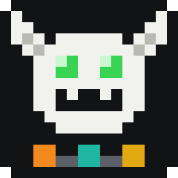
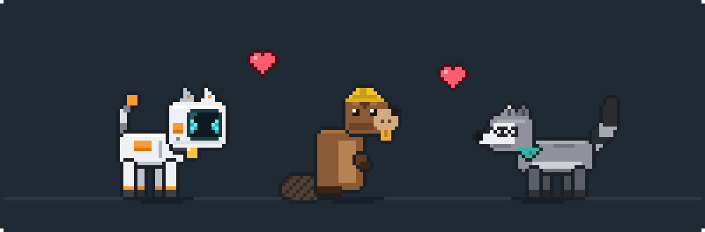
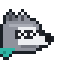
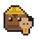
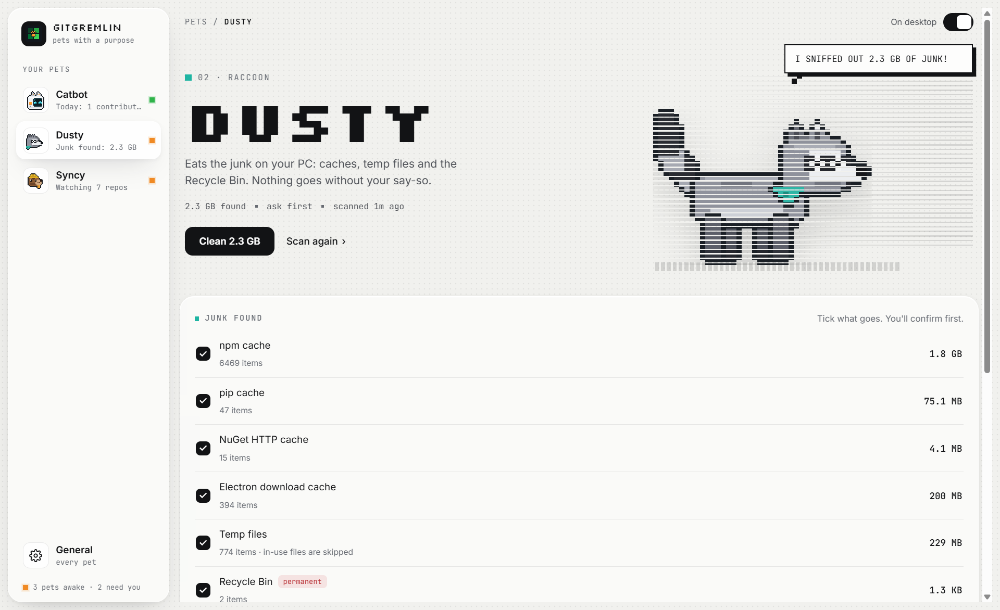

<p align="center">
  
</p>

<h1 align="center">GitGremlin</h1>

<p align="center"><b>Desktop pets with a purpose, for Windows.</b></p>

<p align="center">
  
  
  
  
</p>

<p align="center">
  
</p>

GitGremlin puts little pixel-art pets on your Windows desktop, and each one does a job for you. Catbot keeps an eye on your GitHub contributions. Dusty cleans junk files off your PC. Syncy makes sure your work actually reaches GitHub. They roam, play and talk to you, and you manage them all from one app.

## Contents

- [About](#about)
- [Meet the pets](#meet-the-pets)
- [Features](#features)
- [Installation](#installation)
- [Using GitGremlin](#using-gitgremlin)
- [Privacy and safety](#privacy-and-safety)
- [Troubleshooting](#troubleshooting)
- [Known limitations](#known-limitations)
- [Documentation](#documentation)
- [License](#license)

## About

GitGremlin is a home for **pets with a purpose**:

- **Every pet has a job.** It watches something for you, and its mood and behaviour show you how things stand at a glance.
- **Every pet is 2D pixel art drawn in code.** No image files from elsewhere; each pet has its own look and animations.
- **One app manages them all.** The **GitGremlin panel** in your tray turns pets on and off, and holds every pet's settings.
- **It stays out of your way.** By default pets live on your desktop, behind your app windows, and clicks pass through everywhere except on a pet.

## Meet the pets

| | Pet | What it does | Guide |
|:---:|---|---|---|
|  | **Catbot**<br /><sub>robot cat</sub> | Mirrors today's square on your **GitHub contribution chart**: hungry on days you haven't contributed, happier and livelier the greener the square. New contributions feed it. | [Catbot's guide →](docs/pets/catbot.md) |
|  | **Dusty**<br /><sub>raccoon</sub> | Sniffs out **junk files**: developer caches, the Recycle Bin, and optionally temp files and browser caches. Cleans them only the way you allow: ask first, automatically, or report only. | [Dusty's guide →](docs/pets/dusty.md) |
|  | **Syncy**<br /><sub>beaver</sub> | Guards **work that isn't on GitHub**: uncommitted changes, unpushed commits and forgotten stashes across all your repos. Nudges you when work sits too long, gives an end-of-day check, and tidies merged branches. | [Syncy's guide →](docs/pets/syncy.md) |

More pets are on the way.

## Features

- **One panel for every pet.** Click the tray icon to open the GitGremlin panel. It lists your pets with what each is up to, and gives each pet a page for its job and its look. Changes save as you make them.
- **Lives on your desktop.** Pets sit just above the wallpaper, so your app windows cover them. Or turn on **Show pets on top of apps** to keep them above everything.
- **Hover to read their minds.** Hover over a pet to see its status report in a speech bubble. Click a pet that wants something (sign in, review junk) and its page opens in the panel.
- **Roams freely.** Pets walk, run, crawl and hop anywhere on the screen. They sit, get curious, walk between monitors and jump onto the window you're working in. Or keep a pet along the bottom of the screen.
- **Plays with you.** Pets can follow your cursor, and you can pick them up, drag them and toss them.
- **Crisp pixel art.** Everything is drawn in whole device pixels, so it stays sharp at any Windows scaling.
- **A real Windows app.** Open it from the Start menu or search, pin it, and start it with Windows.
- **Light on your PC.** Rendering slows down when nothing on screen changes, and the only network access is Catbot's read-only GitHub check.

## Installation

GitGremlin runs on **Windows 10 or 11 (x64)**. These steps install it as a normal Windows app: you open it from the Start menu or the taskbar search box, can pin it, and can start it with Windows. You use the terminal only once, to set it up.

**You need:**

| Tool | Why | Version |
|---|---|---|
| [Node.js](https://nodejs.org/) (includes npm) | Installs GitGremlin's packages and builds the app | 22.12 or newer (the current LTS is recommended) |
| [Git](https://git-scm.com/) | Downloads the project, and Syncy uses it to check your repos | any recent version |
| winget (App Installer) | Installs the two tools above with one command each | comes with Windows 10 (1809+) and 11 |
| A GitHub account | For Catbot, which reads your contribution chart | – |

You don't install **Electron** yourself: it's one of the project's packages, and step 4 installs it. All commands below are for **Windows PowerShell** (search "PowerShell" in the Start menu).

### 1. Check what's already installed

Paste this into PowerShell. It lists each tool and its version, or says it's missing:

```powershell
foreach ($t in 'winget', 'node', 'npm', 'git') {
  if (Get-Command $t -ErrorAction SilentlyContinue) {
    $v = (& $t --version 2>$null) | Select-Object -First 1
    Write-Host ("{0,-7} installed   {1}" -f $t, $v) -ForegroundColor Green
  } else {
    Write-Host ("{0,-7} NOT INSTALLED" -f $t) -ForegroundColor Red
  }
}
if (Get-Command node -ErrorAction SilentlyContinue) {
  node -e "const [a,b]=process.versions.node.split('.').map(Number); console.log(a>22||(a===22&&b>=12) ? 'Node.js version OK' : 'Node.js is too old: update it in step 2')"
}
```

If everything is installed and the Node.js version is OK, skip to step 3.

### 2. Install what's missing

Each command installs a tool only if it isn't there yet:

```powershell
# Node.js LTS (includes npm)
if (Get-Command node -ErrorAction SilentlyContinue) { "Node.js is already installed: $(node --version)" } else { winget install --id OpenJS.NodeJS.LTS -e --source winget }

# Git
if (Get-Command git -ErrorAction SilentlyContinue) { "Git is already installed: $(git --version)" } else { winget install --id Git.Git -e --source winget }
```

Node.js installed but too old? Update it:

```powershell
winget upgrade --id OpenJS.NodeJS.LTS -e --source winget
```

Then **close PowerShell and open a new window**, so it picks up the new commands, and run the check from step 1 again.

<details>
<summary>No winget? Install them by hand</summary>

- **winget** itself: install or update **App Installer** from the Microsoft Store.
- **Node.js:** download the LTS installer (`.msi`) from <https://nodejs.org/> and keep the default options.
- **Git:** download the installer from <https://git-scm.com/download/win> and keep the default options.

</details>

### 3. Download GitGremlin

Pick a folder for it. This example uses `D:\git-gremlin`. Any folder works, but **keep it there afterwards**, because the Start menu shortcut points to it.

```powershell
cd D:\
git clone https://github.com/premkajiwala-hub/git-gremlin.git
cd git-gremlin
```

Without Git: on the GitHub page, click **Code → Download ZIP** and extract it (for example to `D:\git-gremlin`). Then run `cd D:\git-gremlin` in PowerShell.

### 4. Install GitGremlin's packages (including Electron)

```powershell
npm install
```

This installs everything the project needs into `node_modules`: Electron, electron-vite (the build tool), TypeScript and koffi (a small Windows helper). It takes a minute or two.

Check that Electron works. The first run downloads the Electron runtime (about 100 MB), then prints its version:

```powershell
npx electron --version
```

> **If npm says install scripts were blocked** (npm 11+ asks first): run `npm install-scripts approve koffi electron-winstaller`, then `npm rebuild`.

### 5. Install GitGremlin as a Windows app

```powershell
npm run install-app
```

This builds GitGremlin and adds **GitGremlin**, with its icon, to your Start menu. To double-check:

```powershell
Test-Path "$env:APPDATA\Microsoft\Windows\Start Menu\Programs\GitGremlin.lnk"
```

`True` means it's installed. Optionally, put a shortcut on your desktop too:

```powershell
Copy-Item "$env:APPDATA\Microsoft\Windows\Start Menu\Programs\GitGremlin.lnk" ([Environment]::GetFolderPath('Desktop'))
```

### 6. Open GitGremlin

1. Press the **Windows key** (or click the taskbar search box), type **GitGremlin**, and press **Enter**.
2. The pets appear on your desktop, and the GitGremlin icon appears in the system tray, bottom right. It may be hidden under the **^** arrow.
3. Click the tray icon to open the **GitGremlin panel**:
   - **Catbot → Sign in with GitHub** links your contribution chart.
   - **Dusty** shows the junk it finds. Nothing is deleted until you confirm.
   - **General → Start GitGremlin with Windows** brings the pets back every time you sign in.

To keep it handy, right-click **GitGremlin** in the Start menu and choose **Pin to Start** or **Pin to taskbar**. Opening GitGremlin while it's already running opens the panel. To stop it, right-click the tray icon and choose **Quit**.

> **Why not a normal installer?** Windows 11's **Smart App Control** blocks unsigned installers, and GitGremlin isn't code-signed. Instead, the Start menu shortcut runs the signed Electron runtime with your GitGremlin folder, which Smart App Control allows. On PCs without Smart App Control you can also use the [installer from GitHub Actions](docs/development.md#building-the-installer).

### Updating

```powershell
cd D:\git-gremlin
git pull
npm install
```

Then open GitGremlin as usual. If the code changed, it rebuilds itself on start, which takes a few seconds, and then launches. If GitGremlin was running during the update, quit it from the tray first.

### Uninstalling

1. In the panel, turn off **Start GitGremlin with Windows**, then choose **Quit** from the tray icon.
2. Remove the shortcut, your GitGremlin data (settings, pet positions, the encrypted GitHub token) and the project folder:

   ```powershell
   Remove-Item "$env:APPDATA\Microsoft\Windows\Start Menu\Programs\GitGremlin.lnk"
   Remove-Item -Recurse -Force "$env:APPDATA\GitGremlin"
   Remove-Item -Recurse -Force D:\git-gremlin
   ```

3. Optionally, remove GitGremlin's access to your GitHub account under GitHub → Settings → Applications → *Authorized OAuth Apps*.

Node.js and Git stay installed. If you don't need them, remove them with `winget uninstall --id OpenJS.NodeJS.LTS -e` and `winget uninstall --id Git.Git -e`.

## Using GitGremlin

### The GitGremlin panel

<p align="center">
  
</p>

Click the tray icon to open it. The sidebar lists every pet with a status dot:
- 🟢 on the desktop;
- 🟠 wants your attention;
- ⚪ off.

| Page | What's there |
|---|---|
| **A pet's page** | An **On desktop** switch, the pet's own job settings (see its guide), and **Look and movement** |
| **General** | **Show pets on top of apps** and **Start GitGremlin with Windows** |

**Look and movement** is the same for every pet:

| Setting | What it does |
|---|---|
| **Name** | Shown in its speech bubble and the tray |
| **Size** | 48–112 px tall, snapped to crisp whole pixels |
| **Walking speed** | Running is about 2.4× and crawling 0.45× this |
| **Where it wanders** | Anywhere on the screen, or only along the bottom |
| **Follow my cursor** | Walks after the cursor while you move it over the desktop |

### The tray icon

- **Click** to open the panel.
- **Right-click** for quick actions:
  - one submenu per pet, with its status, **Show on desktop** and its own actions;
  - **Hide all pets for 1 hour** / **Show pets**;
  - **Start with Windows**;
  - **Quit**.

### Playing with the pets

| Do this | The pet does this |
|---|---|
| Move the cursor over the desktop | Follows it (if **Follow my cursor** is on) and stops when it reaches it |
| Hover over it | Stops, faces you and shows its status report until you move away |
| Click it | Looks up and shows its report; if it wants something, its page opens in the panel |
| Drag it | Dangles from your cursor |
| Toss it | Flies, bounces off the screen edges and may land on a window; flick it hard for a red flash |

Pets are awake the whole time GitGremlin runs. Turn one off with its switch, or quit from the tray.

## Privacy and safety

- **Your GitHub account:** Catbot links through GitHub's own sign-in, with read-only access. The token is stored encrypted on your PC. [Details →](docs/pets/catbot.md#privacy-and-your-github-account)
- **Your files:** Dusty only looks in a fixed list of junk locations inside your user folders. It never follows links, skips files in use, and by default deletes nothing until you confirm. [Safety rules →](docs/pets/dusty.md#safety-rules)
- **Your repos:** Syncy only reads them with git. It never fetches or pushes, and the only change it can make is deleting merged local branches, after you confirm. [Safety →](docs/pets/syncy.md#safety)
- **Network:** the only network access is Catbot's GitHub check. Syncy works offline.
- **Your data stays local:** settings and state are in `%APPDATA%\GitGremlin\state.json`.

## Troubleshooting

| Problem | Fix |
|---|---|
| `'node'`, `'npm'` or `'git'` is not recognized | Close PowerShell and open a new window after installing. If that doesn't help, sign out of Windows and back in. |
| `npm.ps1 cannot be loaded because running scripts is disabled` | Run `Set-ExecutionPolicy -Scope CurrentUser RemoteSigned`, or use `npm.cmd` instead of `npm` (for example `npm.cmd install`). |
| `winget` is not recognized | Install or update **App Installer** from the Microsoft Store, or install Node.js and Git by hand (step 2). |
| `npm install` fails with network errors | Check your internet connection or proxy, then run `npm install` again. |
| `Failed to load URL: ... hub.html ... ERR_FILE_NOT_FOUND` | The built copy is out of date. Quit GitGremlin from the tray and run `npm run install-app` again. |
| Nothing happens when you open GitGremlin | It's probably already running: look for its tray icon. If it's stuck, end **Electron** in Task Manager and open GitGremlin again. |
| `Unable to move the cache: Access is denied` | Two copies were running at once. Quit GitGremlin, end any leftover **Electron** processes, and open it again. |
| The pets don't show | App windows hide them in desktop mode: press **Win+D**, or turn on **Show pets on top of apps**. Also check each pet's **On desktop** switch. |

## Known limitations

- **In desktop mode, app windows hide the pets** (that's the point), and pets only follow the cursor over the visible desktop.
- **Full-screen games and apps cover the pets, even in on-top mode.** So do the Start menu, notification centre, Alt+Tab and Task View.
- Window hopping uses the **focused** window only, and skips maximised and full-screen windows.
- Dragging works only on the monitor the pet is on. To change monitors, toss it or let it walk.
- Each pet has its own limits; see [Catbot's](docs/pets/catbot.md#limitations), [Dusty's](docs/pets/dusty.md#limitations) and [Syncy's](docs/pets/syncy.md#limitations) guides.

## Documentation

| Guide | What's inside |
|---|---|
| [Catbot](docs/pets/catbot.md) | Linking GitHub, how its mood works, feeding, settings, privacy |
| [Dusty](docs/pets/dusty.md) | Cleaning modes, where it looks, safety rules, settings |
| [Syncy](docs/pets/syncy.md) | What counts as unsaved work, where it looks, nudges, merged branches, safety |
| [Development guide](docs/development.md) | Dev mode, project structure, how it works, pet art, adding a pet, building the installer |

## License

[MIT](LICENSE). All pet art is original to this project and drawn in code.
