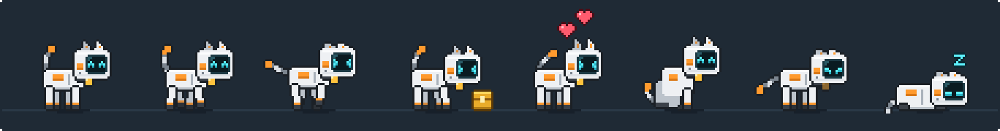

<sub>[← GitGremlin](../../README.md) · **Catbot** · [Dusty →](dusty.md)</sub>

<p align="center">
  
</p>

<h1 align="center">Catbot</h1>

<p align="center"><b>A robot cat that runs on your GitHub contributions.</b><br />No contributions today? Catbot gets hungry. A green day on your chart makes it happy and lively.</p>

<p align="center">
  
  <br /><sub>Idle · walk · run · eating a commit cube · happy · sit · hungry · asleep</sub>
</p>

## At a glance

| | |
|---|---|
| **Species** | Robot cat: white shell, orange ear tips and stripes, a striped cable tail, a collar bell and a dark face-screen with glowing cyan eyes |
| **Job** | Mirrors today's square on your GitHub contribution chart |
| **Feeds on** | Your contributions: commits, pull requests, issues and reviews that GitHub counts on your profile |
| **Needs** | A GitHub account, linked once through GitHub's own sign-in |
| **Panel page** | GitGremlin panel → **Catbot** |

## Contents

- [Getting started](#getting-started)
- [How Catbot's mood works](#how-catbots-mood-works)
- [Feeding](#feeding)
- [What Catbot tells you](#what-catbot-tells-you)
- [Settings](#settings)
- [Privacy and your GitHub account](#privacy-and-your-github-account)
- [Art and animations](#art-and-animations)
- [Limitations](#limitations)

## Getting started

1. Open the **GitGremlin panel** (click the tray icon) and choose **Catbot**.
2. Click **Sign in with GitHub**. GitGremlin shows a one-time code, copies it to your clipboard and opens <https://github.com/login/device>.
3. Paste the code on GitHub and approve **GitGremlin**.
4. The panel shows your avatar, name and @username, and Catbot greets you on the desktop.

Already signed in with the [GitHub CLI](https://cli.github.com/) (`gh auth login`)? The panel also offers **Use my GitHub CLI login instead**.

Until you link an account, Catbot reminds you now and then. Clicking it opens its page in the panel.

## How Catbot's mood works

Catbot follows **today's square** on your contribution chart, on GitHub's own *Less → More* scale:

| Today on your chart | Mood | What Catbot does |
|---|---|---|
| ⬛ 0 contributions | **Hungry** | Dimmed, sad eyes, droopy ears and tail; moves at half speed and sits a lot |
| ⬛ 0 today **and** yesterday | **Starving** | Flops over and twitches, bell dark; now and then crawls to your focused window and taps on it |
| 🟩 Level 1 ("Less") | **Fed, calm** | `^ ^` eyes, bell lit, an unhurried walk |
| 🟩 Level 2 | **Content** | Normal speed; wanders, sometimes runs and hops onto windows |
| 🟩 Level 3 | **Happy** | Faster, springy walk, more running and hopping, little happy dances |
| 🟩 Level 4 ("More") | **Ecstatic** | Fastest; zoomies, lots of hops and dances, beaming `> <` all the time |

- The levels are GitHub's own (relative to your usual activity), so Catbot matches the colour you see on your profile.
- "Today" is your PC's local date. Each new day starts hungry until you contribute again.
- Every contribution GitHub counts on your profile counts for Catbot, in any repository.

## Feeding

GitGremlin re-reads your chart **every 3 minutes**, when your PC wakes or unlocks, and when you choose **Refresh GitHub now** (tray → Catbot, or the panel).

When today's count goes up, Catbot eats a golden **commit cube**: its head dips, crumbs fly, it says `+N CONTRIBUTIONS`, then hops happily with hearts. If today's square moves up a level, it announces that too.

## What Catbot tells you

**Hover** over Catbot to see its status report for as long as you hover. **Click** it to see the report again with a fresh line.

```
TODAY: 5 CONTRIBUTIONS
MOOD: FED, LEVEL 2/4
STREAK: 5 DAYS
LAST 7 DAYS:
▢ ▢ ▢ ▢ ▢ ▢ ▣      (drawn as green squares)

> SMALL COMMITS = HAPPY CIRCUITS.
```

Now and then it also makes a remark that fits its mood:
- Hungry: "LOW BATTERY... FEED ME COMMITS".
- Busy day: "YOUR GRAPH IS GLOWING GREEN!".

## Settings

GitGremlin panel → **Catbot**:

| Setting | What it does | Default |
|---|---|---|
| **On desktop** | Shows or hides Catbot | On |
| **GitHub** | Sign in, refresh, sign out; shows today's count, streak and last 7 days | Not linked |
| **Name** | Shown in its message box and the tray | Catbot |
| **Size** | Height on screen, 48–112 px (snapped to crisp whole pixels) | 72 px |
| **Walking speed** | Running is about 2.4× and crawling 0.45× this | 45 px/s |
| **Where it wanders** | Anywhere on the screen, or only along the bottom | Anywhere |
| **Follow my cursor** | Walks after the cursor while you move it over the desktop | On |

Tray → **Catbot** also has **Refresh GitHub now** and **Feed (debug)**.

## Privacy and your GitHub account

- **GitHub's own sign-in.** GitGremlin uses GitHub's OAuth *device flow*, the same one the GitHub CLI and VS Code use. You approve it on github.com, so your password never touches the app.
- **Read-only.** It asks only for `read:user`, and reads only your contribution calendar.
- **Stored encrypted.** The token is encrypted on your PC with Windows DPAPI (Electron `safeStorage`). It is never written to disk in plain text.
- **Easy to undo.** **Sign out** in the panel forgets the token. To revoke access completely, remove GitGremlin under GitHub → Settings → Applications → *Authorized OAuth Apps*.
- **The only network access** in GitGremlin is the GitHub GraphQL API (`viewer.contributionsCollection.contributionCalendar`).

> **Forks and your own builds:** sign-in uses GitGremlin's GitHub OAuth App (its client ID in `src/shared/constants.ts` is a public identifier, not a secret). To use your own app, register an OAuth App under GitHub → Settings → Developer settings → OAuth Apps with **Enable Device Flow** ticked and token expiry off. Then set `GITHUB_CLIENT_ID`, or the `GITGREMLIN_GITHUB_CLIENT_ID` environment variable.

## Art and animations

Catbot is drawn entirely in code, in [`scripts/art/catbot.ts`](../../scripts/art/catbot.ts), and exported to [`assets/pets/catbot/`](../../assets/pets/catbot/):

| Animation | Used for |
|---|---|
| `idle`, `idle_sad` | Standing, with blinks and tail sway (fed / hungry) |
| `walk`, `walk_sad`, `run`, `crawl` | Getting around |
| `sit`, `sleep`, `curious` | Resting and reacting to your cursor |
| `jump_up`, `jump_down`, `dragged`, `hurt` | Hops, falls, being carried and being flicked hard |
| `eat`, `happy` | Eating a commit cube, then a happy hop |
| `starving`, `tap` | Flopped over; tapping on a window for food |

| Overlay | |
|---|---|
| `eyes_*.png` | Face-screen expressions: idle `^ ^`, blink, happy `> <`, hurt `x x`, alert, sad |
| `accent_on.png` | The collar bell, lit while Catbot is fed |
| `food.png` | The golden commit cube |

The [design reference](../images/catbot-reference.webp) Catbot was drawn from is in `docs/images`. To repaint or regenerate the art, see the [development guide](../development.md#pet-art).

## Limitations

- GitHub can take a few minutes to show a pushed commit on your chart. Commits you haven't pushed don't count.
- Only contributions GitHub counts appear on the chart. For example, commits made with an email that isn't linked to your account, or commits that stay in a fork, don't count. See GitHub's [Why are my contributions not showing up on my profile?](https://docs.github.com/en/account-and-profile/setting-up-and-managing-your-github-profile/managing-contribution-settings-on-your-profile/why-are-my-contributions-not-showing-up-on-my-profile).
- Offline, Catbot keeps its last known mood until it can refresh.

---

<sub>[← Back to GitGremlin](../../README.md) · [Dusty →](dusty.md)</sub>
