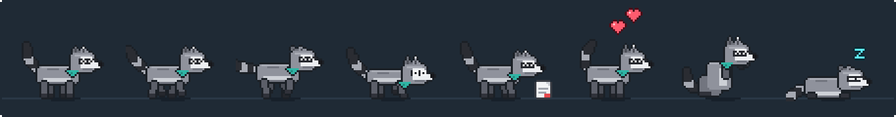
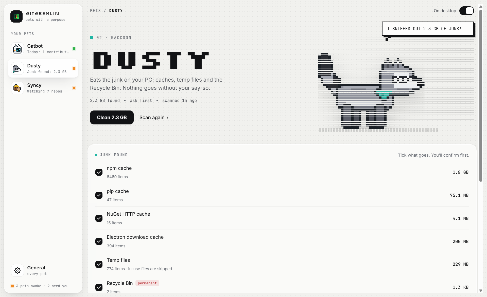

<sub>[← Catbot](catbot.md) · **Dusty** · [Syncy →](syncy.md)</sub>

<p align="center">
  
</p>

<h1 align="center">Dusty</h1>

<p align="center"><b>A raccoon that eats the junk on your PC, safely.</b><br />Dusty sniffs out caches, temp files and the Recycle Bin, and cleans them only the way you allow.</p>

<p align="center">
  
  <br /><sub>Idle · walk · run · rummaging for junk · eating a junk file · happy · washing its paws · asleep</sub>
</p>

## At a glance

| | |
|---|---|
| **Species** | Raccoon (a "trash panda"): grey fur, a dark eye mask, a bushy ringed tail and a teal bandana |
| **Job** | Finds junk files and caches and frees up disk space |
| **Feeds on** | Junk: developer caches, the Recycle Bin, and optionally temp files and browser caches |
| **Default mode** | **Ask me first**: nothing is deleted until you confirm |
| **Panel page** | GitGremlin panel → **Dusty** |

## Contents

- [Getting started](#getting-started)
- [Cleaning modes](#cleaning-modes)
- [Where Dusty looks](#where-dusty-looks)
- [Safety rules](#safety-rules)
- [Dusty at work](#dusty-at-work)
- [Settings](#settings)
- [Art and animations](#art-and-animations)
- [Limitations](#limitations)

## Getting started

Dusty starts working as soon as GitGremlin runs:

1. Shortly after start-up it **scans** the places it's allowed to look. It does this again every hour, and whenever you click **Scan now**.
2. If it finds 50 MB of junk or more, it tells you, for example: `I SNIFFED OUT 1.2 GB OF JUNK! RIGHT-CLICK ME TO REVIEW.`
3. Right-click Dusty and choose **Review junk...** (or open the panel → **Dusty**) to see exactly what it found: each kind of junk with its size and number of files.
4. Tick what you want gone and click **Clean**. A confirmation lists everything that will be deleted. Dusty eats it, tells you how much it freed, and washes its paws.

<p align="center">
  
</p>

## Cleaning modes

You choose what Dusty does with the junk it finds:

| Mode | What happens |
|---|---|
| **Ask me first** *(default, recommended)* | Dusty reports what it found. Nothing is deleted until you tick what to clean and confirm. |
| **Clean automatically** | After each scan Dusty cleans caches and temp files by itself. It **always asks** before emptying the Recycle Bin, because that's permanent. |
| **Only report** | Dusty shows what it found and never deletes anything. The Clean button is hidden. |

## Where Dusty looks

Dusty only ever looks in these places, and you choose which ones:

| Target | Default | What's in it |
|---|---|---|
| **Developer caches** | On | npm (`npm-cache\_cacache`), Yarn, pnpm metadata, pip, NuGet HTTP and plugin caches, and Electron / electron-builder download caches. Tools download what they need again. |
| **Recycle Bin** | On | Files you've already deleted. Emptied through Windows itself; permanent, so it's always confirmed. |
| **Temp files** | Off | Everything currently in your `%TEMP%` folder. Files that programs are using right now are skipped. |
| **Browser caches** | Off | Chrome, Edge and Brave (`Cache`, `Code Cache`, `GPUCache` in each profile) and Firefox (`cache2`). Never history, passwords or cookies. Skipped while that browser is open. |

When you switch on a new target, Dusty scans again right away so you see its size.

> **Tip:** cleaning Temp removes everything that isn't locked, including working files that some programs (installers, for example) are still using. Close what you can before cleaning Temp.

## Safety rules

Deleting files can't be undone, so Dusty follows strict rules, enforced in [`src/main/junk.ts`](../../src/main/junk.ts):

- **Known places only.** Dusty touches only the locations listed above, and only what's *inside* them. The folders themselves stay.
- **Inside your user folders only.** Every path must resolve inside `%LOCALAPPDATA%`, `%APPDATA%` or `%TEMP%`, or it's refused.
- **No following links.** Links and junctions are never followed: deleting one removes the link, never what it points to.
- **Files in use are left alone.** They're skipped one by one and counted, and the rest of their folder is still cleaned.
- **You see what goes.** Only junk from the latest scan can be cleaned, and the panel always confirms first, listing exactly what will be deleted.
- **The Recycle Bin always asks**, even in automatic mode.
- **No network.** Dusty works entirely on your PC.

## Dusty at work

| What Dusty is doing | What you see on the desktop |
|---|---|
| Scanning | Trots around and rummages, little bits flying |
| Found junk (ask mode) | Now and then says how much it found; its status dot in the panel turns orange |
| Cleaning | Munches a junk file for as long as the job takes |
| Finished | Says how much it ate (`MUNCHED 1.2 GB OF JUNK!`), hops happily, then washes its paws |

Its mood follows how tidy your PC is:
- It's happiest right after a clean.
- It's content when there's little junk.
- It gets a bit restless when junk piles up.

**Hover** over Dusty for its status report:

```
JUNK FOUND: 1.2 GB
MODE: ASK FIRST
LAST SCAN: 3M AGO
LAST CLEAN: 2H AGO (850 MB)

> RIGHT-CLICK ME TO REVIEW AND CLEAN.
```

## Settings

GitGremlin panel → **Dusty**:

| Setting | What it does | Default |
|---|---|---|
| **On desktop** | Shows or hides Dusty (and pauses its scans) | On |
| **What Dusty does with junk** | Ask me first, Clean automatically, or Only report | Ask me first |
| **Where Dusty looks** | Developer caches, Recycle Bin, Temp files, Browser caches | Developer caches + Recycle Bin |
| **Scan every** | 15 minutes, 30 minutes, 1 hour, 3, 6 or 12 hours, or once a day | 1 hour |
| **Name** | Shown in its message box and the tray | Dusty |
| **Size** | Height on screen, 48–112 px (snapped to crisp whole pixels) | 64 px |
| **Walking speed** | Running is about 2.4× and crawling 0.45× this | 40 px/s |
| **Where it wanders** | Anywhere on the screen, or only along the bottom | Anywhere |
| **Follow my cursor** | Walks after the cursor while you move it over the desktop | Off |

Tray → **Dusty** also has **Scan for junk now** and **Review and clean...**.

## Art and animations

Dusty is drawn entirely in code, in [`scripts/art/dusty.ts`](../../scripts/art/dusty.ts), and exported to [`assets/pets/dusty/`](../../assets/pets/dusty/):

| Animation | Used for |
|---|---|
| `idle`, `idle_sad` | Standing, with blinks and tail sway |
| `walk`, `walk_sad`, `run`, `crawl` | Getting around |
| `rummage` | Digging for junk while scanning |
| `eat`, `happy`, `wash` | Eating, a happy hop, then washing its paws |
| `sit`, `sleep`, `curious` | Resting and reacting to your cursor |
| `jump_up`, `jump_down`, `dragged`, `hurt` | Hops, falls, being carried and being flicked hard |
| `starving`, `tap` | Shared with every pet (Dusty never goes hungry, so it doesn't use them) |

| Overlay | |
|---|---|
| `eyes_*.png` | Expressions inside the mask: idle, blink, happy, hurt, alert, sad |
| `food.png` | A junk file |

To repaint or regenerate the art, see the [development guide](../development.md#pet-art).

## Limitations

- Dusty only knows the locations listed above. Caches of other tools are left alone.
- Files locked by running programs are skipped, so a little junk may stay until those programs close.
- Browser caches can only be cleaned while that browser is closed.
- Dusty can't reach system-wide folders such as `C:\Windows\Temp`, which need administrator rights.

---

<sub>[← Catbot](catbot.md) · [Back to GitGremlin](../../README.md) · [Syncy →](syncy.md)</sub>
