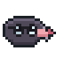
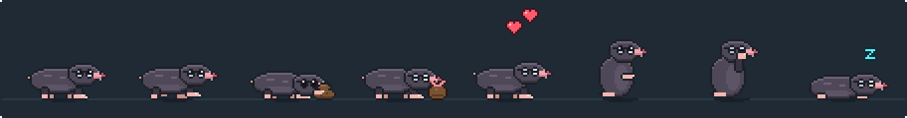

<sub>[← Syncy](syncy.md) · **Mole** · [Rex →](rex.md) · [Back to GitGremlin](../../README.md)</sub>

<p align="center">
  
</p>

<h1 align="center">Mole</h1>

<p align="center"><b>A mole that digs through your ports and frees the one you need.</b><br />You run <code>npm run dev</code> and port 3000 is already taken. Mole tells you who's sitting on it, and stops it in two clicks.</p>

<p align="center">
  
  <br /><sub>Idle · walk · digging (checking your ports) · eating a worm · happy · sitting up · polishing its glasses · asleep</sub>
</p>

## At a glance

| | |
|---|---|
| **Species** | Mole: slate-grey velvet fur, a pink pointed snout, huge pink digging paws and round glasses (moles barely see) |
| **Job** | Knows which program holds which port, warns you when a project you start finds its port taken, and frees a port when you ask |
| **Feeds on** | Freed ports: every time it frees one for you, it eats a worm |
| **Needs** | Nothing. No sign-in, no network: it reads ports and processes from Windows |
| **Panel page** | GitGremlin panel → **Mole** |

## Contents

- [Getting started](#getting-started)
- [Freeing a port](#freeing-a-port)
- [Port taken warnings](#port-taken-warnings)
- [Running servers](#running-servers)
- [Servers left running](#servers-left-running)
- [Safety](#safety)
- [Mole at work](#mole-at-work)
- [Settings](#settings)
- [Art and animations](#art-and-animations)
- [Limitations](#limitations)

## Getting started

Mole needs no setup. It starts watching as soon as GitGremlin runs:

1. Start a dev server as usual (`npm run dev`, `python manage.py runserver`...). Mole says it's up, for example `WEB IS UP ON :5173!`
2. Hover over Mole to see every dev server and its port.
3. Need a port that's taken? **Right-click Mole → Free a port**, pick the server, and confirm.

## Freeing a port

There are three ways, all of which ask before stopping anything:

| Where | How |
|---|---|
| **Right-click Mole** | **Free a port** lists every running dev server by port. When a port is taken, the first item is **Free :3000 (stop …)** |
| **Panel → Mole → Free a port** | Type a port (or click `:3000`, `:5173`, `:8000`...) and **Who has it?** shows the program holding it, with **Stop** and **Use :3001 instead** (copies the next free port, to start your project there) |
| **Panel → Mole → Running servers** | **Stop** on any server |

The confirmation names the server, its project folder and how long it has run.

When you confirm, Mole stops the server and anything it started. It goes up to the launcher in the same project (`npm run dev`, `nodemon`), but never closes your terminal. Then it checks that the port is really free and eats a worm:

> `:3000 IS FREE! SLURP.`

## Port taken warnings

When you start a project whose port is already held by **another program that was there first**, Mole tells you right away and turns its dot red:

| What happened | What Mole says |
|---|---|
| The port is held by another project | `WEB WANTS :3000 BUT API HAS IT.` |
| The tool moved to the next port by itself (Vite, Next.js) | `WEB MOVED TO :3001. :3000 IS TAKEN BY API.` |
| The same project is already running (an old copy) | `WEB IS ALREADY RUNNING ON :3000.` |

The **Port taken** card at the top of Mole's page has **Free :3000** and **Use :3001 instead**. It goes away once the port changes hands, or a few minutes after you stop trying.

To know which port a project wants, Mole checks these, in order:

1. The command: `--port 4000`, `-p 4000`, `runserver 8000`, `localhost:4000`.
2. `PORT=4000` in the project's `.env`.
3. **The port that project used last time.** Mole remembers it for each project.
4. The script itself: `process.env.PORT || 3000` or `.listen(3000)`.
5. The tool's default: Next.js, Create React App, Nuxt, Remix and Rails 3000; Vite 5173; Angular 4200; Astro 4321; Django, Gatsby and uvicorn 8000; Flask 5000; webpack and http-server 8080; Storybook 6006.

## Running servers

The **Running servers** card is live and updates every second. For each dev server it shows:

- **Project name** (its folder) and what it runs: `vite`, `next`, `server.js`...
- **Ports:** click one to open `localhost:<port>` in your browser.
- **On your network:** it listens on every network interface, so other devices on your Wi-Fi can reach it, not just this PC.
- **Left running · no terminal:** see below.
- **VS Code**, **Folder** and **Stop**.

A *dev server* is a program like Node, Python, Java, .NET, Ruby, PHP, Go or Deno, started from a project folder (one with `package.json`, `.git`, `pyproject.toml`, `manage.py`, `go.mod`...). Turn on **Show databases and apps** to also list databases (MySQL, PostgreSQL, Redis, MongoDB...) and other apps that listen on ports. Windows' own services never appear in the list, though **Who has it?** still names them.

## Servers left running

Close a terminal and its dev server sometimes keeps running in the background, holding its port. Mole notices when the terminal (or tool) that started a server is gone and marks it **left running · no terminal**. After 30 minutes (you can change this), it nudges you:

> `2 SERVERS LEFT RUNNING WITH NO TERMINAL. RIGHT-CLICK ME.`

## Safety

- **It only reads until you ask.** Mole reads the list of listening ports and processes straight from Windows: each check takes a few milliseconds and starts no programs.
- **Nothing stops without your OK.** Every stop asks first, in the panel or in a Windows dialog.
- **Stops only what it lists.** It only stops a server it currently sees listening. It never stops Windows itself or GitGremlin, and never climbs past your terminal.
- **Services stay put.** Programs running as a Windows service or as admin (like a MySQL service) can't be stopped from GitGremlin. Mole says so instead of trying harder.
- **No network.** Opening `localhost:<port>` in your browser is the only thing that leaves the app, and only when you click a port.

## Mole at work

| What Mole is doing | What you see on the desktop |
|---|---|
| A server starts | `WEB IS UP ON :5173!` |
| Now and then | Digs into a little dirt mound, sniffing out your ports |
| A port is taken | Says who has it, and digs frantically |
| You freed a port | Eats a worm, hops with hearts, then polishes its glasses |

**Hover** over Mole for its report:

```
2 DEV SERVERS RUNNING
:3000 API (LEFT RUNNING)
:5173 WEB
PORT FIGHT: SHOP WANTS :3000 BUT API HAS IT.

> RIGHT-CLICK ME TO FREE IT.
```

## Settings

GitGremlin panel → **Mole**:

| Setting | What it does | Default |
|---|---|---|
| **On desktop** | Shows or hides Mole (and pauses its checks) | On |
| **Nudge me about servers left running after** | 15 minutes, 30 minutes, 1 hour or never | 30 minutes |
| **Warn when a port is taken** | The port-taken alert and card | On |
| **Show databases and apps** | List databases and other listening apps, not just dev servers | Off |
| **Name**, **Size**, **Walking speed**, **Where it wanders**, **Follow my cursor** | Look and movement, as for every pet | Mole, 60 px, 36 px/s, along the bottom, off |

Tray → **Mole** also has **Show running servers...**.

## Art and animations

Mole is drawn entirely in code, in [`scripts/art/mole.ts`](../../scripts/art/mole.ts), and exported to [`assets/pets/mole/`](../../assets/pets/mole/):

| Animation | Used for |
|---|---|
| `idle`, `idle_sad` | Standing, nose twitching |
| `walk`, `walk_sad`, `run`, `crawl` | Getting around on its big pink paws |
| `rummage` | Nose-down, digging into a dirt mound: checking ports, and its warning |
| `eat`, `happy`, `wash` | Eating a worm after freeing a port, a happy hop, then polishing its glasses |
| `sit`, `sleep`, `curious` | Resting and reacting to your cursor |
| `jump_up`, `jump_down`, `dragged`, `hurt` | Hops, falls, being carried and being flicked hard |
| `starving`, `tap` | Shared with every pet (Mole never starves, so it doesn't use them) |

| Overlay | |
|---|---|
| `eyes_*.png` | Expressions behind the glasses: idle, blink, happy, hurt, alert, sad |
| `food.png` | An earthworm on a clod of dirt (the dirt is what flies when it digs) |

To regenerate just Mole's art, run `npm run textures -- mole`. See the [development guide](../development.md#pet-art) for more.

## Limitations

- **Instant crashes are too quick to catch.** A plain `node server.js` that exits with `EADDRINUSE` lives for about a tenth of a second, between Mole's checks, and Windows only reports process starts to admin apps. Tools that wait or switch ports (Vite, Next.js, Create React App, Angular, nodemon) are caught. For the rest, right-click Mole → **Free a port**.
- **"Which port does it want" is a best guess** from the command, `.env`, last time, the script and the tool's default. A port computed at runtime can't be known.
- **TCP only.** UDP ports aren't listed.
- **Services and admin programs** show up but can't be stopped from GitGremlin.
- **32-bit programs** are listed by name only (no project folder).

---

<sub>[← Syncy](syncy.md) · [Rex →](rex.md) · [Back to GitGremlin](../../README.md)</sub>
