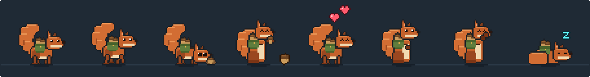

<sub>[← Rex](rex.md) · **Squirrel** · [Back to GitGremlin](../../README.md)</sub>

<p align="center">
  
</p>

<h1 align="center">Squirrel</h1>

<p align="center"><b>A squirrel that keeps your projects inside their free tiers.</b><br />It knows which project runs on which platform, and warns you before a free allowance runs out or a free database goes to sleep.</p>

<p align="center">
  
  <br /><sub>Idle · walk · burying an acorn (checking usage) · nibbling an acorn · happy · sitting up · washing · asleep</sub>
</p>

## At a glance

| | |
|---|---|
| **Species** | Red squirrel: rusty fur, a cream belly, a big bushy tail and an olive backpack with two acorns peeking out |
| **Job** | Maps each of your projects to the platforms it uses, shows each platform's free-tier limits, and (with a read-only key) tracks live usage and warns before you hit a limit |
| **Feeds on** | Resets: when a daily or monthly allowance starts over, it gets fresh acorns |
| **Needs** | Nothing for the map and limits. A read-only key per platform for live usage (optional) |
| **Panel page** | GitGremlin panel → **Squirrel** |

## Contents

- [Getting started](#getting-started)
- [Which project runs where](#which-project-runs-where)
- [Free-tier limits](#free-tier-limits)
- [Live usage](#live-usage)
- [Warnings](#warnings)
- [Safety and privacy](#safety-and-privacy)
- [Squirrel at work](#squirrel-at-work)
- [Settings](#settings)
- [Art and animations](#art-and-animations)
- [Limitations](#limitations)

## Getting started

1. Make sure **Syncy** watches your repos (Squirrel looks in the same folders).
2. Open **GitGremlin panel → Squirrel**. **Your projects** lists each repo with the platforms it uses, and **Platforms** shows their free-tier limits.
3. Optional: for live usage, paste a **read-only key** under a platform in **Platforms** and click **Connect**.

## Which project runs where

Squirrel reads files in each repo (and one folder down, for monorepos). It never runs your code or calls any network for this:

| Platform | Found by |
|---|---|
| **Cloudflare Workers** | `wrangler.toml`, `wrangler.json`, `wrangler.jsonc`, the `wrangler` package, `CLOUDFLARE_*` names |
| **Supabase** | `supabase/config.toml`, a `*.supabase.co` URL or `SUPABASE_*` names in `.env` files, the `@supabase/supabase-js` package |
| **Firebase** | `firebase.json`, `.firebaserc`, `FIREBASE_*` names, the `firebase` package |
| **Cloudinary** | `CLOUDINARY_*` names or a `res.cloudinary.com` URL in `.env` files, the `cloudinary` package |
| **GitHub Actions** | `.github/workflows` |
| **Vercel, Netlify, Render, Railway, Fly.io** | `vercel.json`, `netlify.toml`, `render.yaml`, `railway.json` or `railway.toml`, `fly.toml` |
| **MongoDB Atlas, Neon, Upstash** | Their hosts in `.env` files |

From `.env` files, Squirrel reads only **variable names and hostnames**. Values are never stored or shown. Hover over a platform chip on a project to see which file gave it away. Click the chip to open that platform's usage page.

## Free-tier limits

For each platform in use, **Platforms** shows the free-tier rules that matter most:

| Platform | Limits Squirrel shows |
|---|---|
| **Cloudflare Workers** | 100,000 requests a day (resets at midnight UTC) and 10 ms CPU per request |
| **Supabase** | 500 MB database. Free projects pause after 7 days of low activity |
| **Cloudinary** | 25 credits a month, shared by storage, bandwidth and transformations |
| **Firebase (Spark)** | Firestore: 50,000 reads, 20,000 writes and 20,000 deletes a day |
| **GitHub Actions** | Free on public repos. Only private repos use your monthly minutes |
| **Others** | A short note and a link to the platform's usage page |

## Live usage

Three platforms can be read live, each with a **read-only key** you create and paste yourself:

| Platform | Key | What Squirrel reads |
|---|---|---|
| **Supabase** | A personal access token ([Account → Access Tokens](https://supabase.com/dashboard/account/tokens)) | Each project's status (active, pausing, paused) and its request counts for the last 7 days |
| **Cloudinary** | Your `CLOUDINARY_URL` ([Settings → API Keys](https://console.cloudinary.com/settings/api-keys)) | This month's credits (or storage, bandwidth and transformations on older plans) |
| **Cloudflare** | A custom API token with **Account Analytics: Read** ([API Tokens](https://dash.cloudflare.com/profile/api-tokens)) | Today's Workers requests across your account |

When you click **Connect**, Squirrel reads once to check the key works, then saves it. It checks again every hour (you can change this), or when you click **Check now**.

The **Free tiers** card then shows a bar for each allowance with:

- **used of limit · %**, amber past your warning level and red past 95%,
- **on pace to run out in …** when the current rate would use it all before the reset,
- **resets in …**,
- and, for Supabase, a row per project that is **paused**, **pausing** or **going quiet** (5 or more days without requests).

## Warnings

| What happened | What Squirrel says |
|---|---|
| An allowance crossed your warning level (80% by default) | `CLOUDINARY: 86% OF THE FREE TIER USED!` |
| A Supabase project paused | `SUPABASE: PORTFOLIO IS PAUSED!` |
| A Supabase project has had no requests for 5 days | `SUPABASE: PORTFOLIO MAY PAUSE SOON.` |
| A daily or monthly allowance reset | Eats an acorn: `FRESH ACORNS! CLOUDFLARE WORKERS RESET.` |

While a warning stands, Squirrel's dot turns red and it rummages. Right-click it → **Show the free tier running low...**.

## Safety and privacy

- **Read-only.** Squirrel only reads usage. Create keys with read permissions only. It never changes anything on a platform.
- **Keys stay encrypted on this PC.** They're stored with Windows encryption (Electron `safeStorage`), are never shown again, and are only sent to that platform's own API. **Disconnect** forgets a key.
- **No secrets from your repos.** From `.env` files it keeps only names and hosts, never values.
- **Only official pages.** Links open only on the platforms' own sites.
- **No sign-in.** Without keys, Squirrel works fully offline.

## Squirrel at work

| What Squirrel is doing | What you see on the desktop |
|---|---|
| Checking usage | Buries an acorn in a little dirt mound |
| An allowance is running low | Says which one, and rummages |
| An allowance reset | Eats an acorn and hops with hearts |
| Nothing to worry about | Sits up, washes its face, curls up in its tail to sleep |

**Hover** over Squirrel for its report:

```
5 PLATFORMS IN 4 PROJECTS
- CLOUDINARY: 86% USED
- CLOUDFLARE: 12% USED
LAST CHECK: 5 MIN AGO

> RIGHT-CLICK ME TO SEE IT.
```

## Settings

GitGremlin panel → **Squirrel**:

| Setting | What it does | Default |
|---|---|---|
| **On desktop** | Shows or hides Squirrel (and pauses its checks) | On |
| **Warn me when a free tier is** | 70%, 80% or 90% used | 80% used |
| **Check usage every** | 30 minutes, 1, 3 or 6 hours (connected platforms only) | 1 hour |
| **Name**, **Size**, **Walking speed**, **Where it wanders**, **Follow my cursor** | Look and movement, as for every pet | Squirrel, 60 px, 55 px/s, anywhere, off |

Right-click Squirrel → **Show my free tiers...** or **Check usage now**. The tray's **Squirrel** menu has the same.

## Art and animations

Squirrel is drawn entirely in code, in [`scripts/art/squirrel.ts`](../../scripts/art/squirrel.ts), and exported to [`assets/pets/squirrel/`](../../assets/pets/squirrel/):

| Animation | Used for |
|---|---|
| `idle`, `idle_sad` | Standing, tail swaying |
| `walk`, `walk_sad`, `run`, `crawl` | Getting around, tail bobbing behind |
| `rummage` | Burying an acorn in a dirt mound: checking usage, and its warning |
| `eat`, `happy`, `wash` | Nibbling an acorn after a reset, a happy hop, then washing its face |
| `sit`, `sleep`, `curious` | Sitting up, curled asleep in its tail, and reacting to your cursor |
| `jump_up`, `jump_down`, `dragged`, `hurt` | Hops, falls, being carried and being flicked hard |
| `starving`, `tap` | Shared with every pet (Squirrel never starves, so it doesn't use them) |

| Overlay | |
|---|---|
| `eyes_*.png` | Expressions: idle, blink, happy, hurt, alert, sad |
| `food.png` | An acorn |

To regenerate just Squirrel's art, run `npm run textures -- squirrel`. See the [development guide](../development.md#pet-art) for more.

## Limitations

- **Live usage needs your keys.** Without them, Squirrel shows the map and the published limits only.
- **Firebase, GitHub Actions and the others are limits only.** Firebase has no simple usage API for Spark projects, and GitHub's billing data needs extra permissions. Squirrel links to their usage pages instead.
- **Limits can change.** The free-tier numbers are built in and were checked in November 2026. The platforms' own pages are always the final word.
- **Cloudflare counts Workers requests only.** Other Cloudflare products (R2, KV, D1) aren't read.
- **Detection is a best guess** from files in your repos. A project that talks to a platform only through code at runtime may be missed.

---

<sub>[← Rex](rex.md) · [Back to GitGremlin](../../README.md)</sub>
