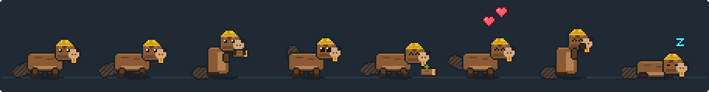

<sub>[← Dusty](dusty.md) · **Syncy** · [Back to GitGremlin →](../../README.md)</sub>

<p align="center">
  
</p>

<h1 align="center">Syncy</h1>

<p align="center"><b>A beaver that guards work you haven't pushed to GitHub.</b><br />Beavers build dams to hold things back. Syncy holds back lost work: uncommitted changes, unpushed commits and forgotten stashes.</p>

<p align="center">
  
  <br /><sub>Idle · walk · gnawing (checking your repos) · tail slap (a nudge) · eating a log · happy · grooming · asleep</sub>
</p>

## At a glance

| | |
|---|---|
| **Species** | Beaver: brown fur, a tan muzzle, big orange front teeth, a flat crosshatched paddle tail and a yellow builder's hard hat |
| **Job** | Finds work in your git repos that isn't safely on GitHub yet, and nudges you before it's lost |
| **Feeds on** | Your pushes: every time commits reach GitHub, Syncy eats a log |
| **Needs** | [Git](https://git-scm.com/) installed. No GitHub sign-in: it reads your repos on disk |
| **Panel page** | GitGremlin panel → **Syncy** |

## Contents

- [Getting started](#getting-started)
- [What Syncy looks for](#what-syncy-looks-for)
- [Where Syncy looks](#where-syncy-looks)
- [Nudges](#nudges)
- [Merged branches](#merged-branches)
- [Safety](#safety)
- [Syncy at work](#syncy-at-work)
- [Settings](#settings)
- [Art and animations](#art-and-animations)
- [Limitations](#limitations)

## Getting started

Syncy needs no setup:

1. About 20 seconds after GitGremlin starts, Syncy finds your git repos and checks each one. It checks again every 10 minutes.
2. Open the GitGremlin panel → **Syncy** to see every repo with work that isn't on GitHub, oldest first.
3. Each repo has quick actions: **Open** (in File Explorer), **VS Code** (opens the repo in Visual Studio Code, ready to commit and push from Source Control; shown when VS Code is installed), **Delete merged** branches and **Ignore**.
4. Push your work. On its next check Syncy notices and celebrates.

Not seeing a repo? Add its folder under **Where Syncy looks**.

## What Syncy looks for

| Kind of unsaved work | What it means | Why it matters |
|---|---|---|
| **Uncommitted changes** | Modified, new or deleted files you haven't committed | Gone if the disk dies or you run the wrong `git checkout` |
| **Commits not on GitHub** | Commits on any local branch that no remote has | They only exist on this PC |
| **Stashes** | Work you stashed with `git stash` | Easy to forget, and stashes are never pushed |
| **No remote** | A repo with nowhere to push to | Nothing in it is backed up |
| **Merged branches** | Local branches already merged into your main branch | Clutter; safe to delete |

Each item shows how old it is. Anything older than your nudge threshold (1 day by default) is marked in red.

## Where Syncy looks

With **Find my repos automatically** on (the default), Syncy searches:

- inside your user folder, one level deep (your user folder itself is skipped, since a stray `git init` there isn't a project);
- common code folders a few levels deep: `source`, `code`, `projects`, `dev`, `repos`, `git`, `src`, `workspace`, `Documents` and `Desktop`;
- your other local drives (like `D:\`) a few levels deep. Network, USB and optical drives are skipped.

It skips folders that never hold your projects, such as `node_modules`, `AppData`, `Windows`, `Program Files`, build output folders and hidden folders. It also stops at each repo, so nested repos and submodules don't show up twice.

You can also:
- **Add folder...** to search folders of your own, 4 levels deep;
- **Ignore** a repo so Syncy leaves it alone, and **Watch again** to bring it back.

## Nudges

When work has been sitting unsaved longer than your threshold, Syncy:

- gets restless; after a week, or with 3 or more repos, it droops;
- now and then says how many repos need you, and **slaps its tail**, the beaver warning;
- turns its dot in the panel orange.

Right-click Syncy and choose **Review unsaved work...** to open its page in the panel.

At **6 PM** each day it gives an **end-of-day check**. You can change the time or turn it off:

> `END OF DAY CHECK: 3 REPOS STILL HAVE WORK THAT ISN'T ON GITHUB. PUSH BEFORE YOU GO?`

When you **push**, Syncy eats a log:

> `5 COMMITS FROM API SAFE ON GITHUB!`

When you **commit**, it reminds you to push.

## Merged branches

With **Find merged branches** on, Syncy lists local branches that are already merged into your default branch (`main` or `master`, or whatever `origin/HEAD` points to). **Delete N merged branches** asks first and lists exactly which branches go.

- Only **local** branches are deleted. Branches on GitHub aren't touched.
- Syncy uses `git branch -d`, so git itself refuses any branch that isn't fully merged.
- Your current branch, the default branch, and branches just created from it (no commits of their own yet) are never listed.
- Branches merged on GitHub with *squash* or *rebase* don't look merged to git, so they aren't listed.

## Safety

- **Read-only checks.** Syncy runs `git status`, `git log`, `git stash list` and `git for-each-ref` with `GIT_OPTIONAL_LOCKS=0`, so it never takes the locks your own git commands need.
- **No network.** It never fetches, pulls or pushes, and needs no GitHub sign-in.
- **The only change it can make** is deleting merged local branches, after you confirm.
- **Panel actions are limited to repos Syncy found** (or ones you ignored). Paths are checked in the main process.

## Syncy at work

| What Syncy is doing | What you see on the desktop |
|---|---|
| Checking your repos | Sits up and gnaws a log |
| Old unsaved work | Restless or droopy; now and then a nudge and a tail slap |
| You pushed | Eats a log, hops with hearts, then grooms its fur |
| Deleting merged branches | Munches until it's done, then says how many it cleared |

**Hover** over Syncy for its report:

```
WATCHING 7 REPOS
NOT ON GITHUB: 3 REPOS
- HEALTHCARE..: 2 UNPUSHED, 14W
- MEWAR_SYNC: 3 UNPUSHED, 6D
- API: 5 CHANGES, 2D
LAST CHECK: 3M AGO

> RIGHT-CLICK ME TO SEE THEM.
```

## Settings

GitGremlin panel → **Syncy**:

| Setting | What it does | Default |
|---|---|---|
| **On desktop** | Shows or hides Syncy (and pauses its checks) | On |
| **Nudge me about work older than** | 4 hours, 1 day, 3 days or 1 week | 1 day |
| **Evening summary** | Off, or a time from 5 PM to 10 PM | 6 PM |
| **Check my repos every** | 5, 10, 15 or 30 minutes, or every hour | 10 minutes |
| **Find merged branches** | List merged local branches and offer to delete them | On |
| **Find my repos automatically** | Search common code folders and local drives | On |
| **Also search these folders** | Your own folders to search | None |
| **Ignored repos** | Repos Syncy leaves alone | None |
| **Name**, **Size**, **Walking speed**, **Where it wanders**, **Follow my cursor** | Look and movement, as for every pet | Syncy, 64 px, 38 px/s, anywhere, off |

Tray → **Syncy** also has **Check my repos now** and **Show unsaved work...**.

## Art and animations

Syncy is drawn entirely in code, in [`scripts/art/syncy.ts`](../../scripts/art/syncy.ts), and exported to [`assets/pets/syncy/`](../../assets/pets/syncy/):

| Animation | Used for |
|---|---|
| `idle`, `idle_sad` | Standing, with blinks and a swaying tail |
| `walk`, `walk_sad`, `run`, `crawl` | Getting around |
| `rummage` | Sitting up gnawing a log: checking your repos |
| `slap` | Raising its paddle tail and slapping it down: a nudge |
| `eat`, `happy`, `wash` | Eating a log after you push, a happy hop, then grooming |
| `sit`, `sleep`, `curious` | Resting and reacting to your cursor |
| `jump_up`, `jump_down`, `dragged`, `hurt` | Hops, falls, being carried and being flicked hard |
| `starving`, `tap` | Shared with every pet (Syncy never starves, so it doesn't use them) |

| Overlay | |
|---|---|
| `eyes_*.png` | Expressions: idle, blink, happy, hurt, alert, sad |
| `food.png` | A short log with a green sprig |

To regenerate just Syncy's art, run `npm run textures -- syncy`. See the [development guide](../development.md#pet-art) for more.

## Limitations

- **"Not on GitHub" is as of your last fetch.** Syncy doesn't fetch, so commits pushed from another computer only count once you fetch or pull here.
- Branches merged by squash or rebase on GitHub don't look merged to git, so Syncy doesn't offer to delete them.
- Syncy only finds repos in the folders it searches. Add others under **Where Syncy looks**.
- Uncommitted changes count files that `.gitignore` doesn't exclude. If a repo always has local-only changes, ignore it or add those files to `.gitignore`.

---

<sub>[← Dusty](dusty.md) · [Back to GitGremlin](../../README.md)</sub>
